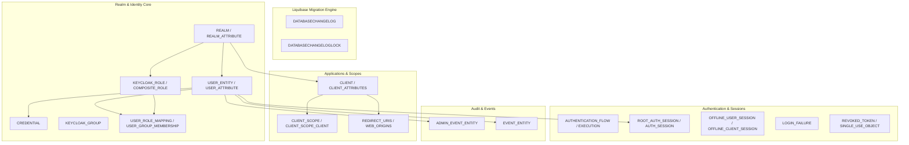

# Keycloak Database Schema & Central RBAC Postman Mapping

This technical reference provides an exhaustive, column-by-column breakdown of Keycloak's relational database architecture and maps the exact tables and columns read, written, and deleted when running [`central-rbac.postman_collection.json`](file:///Users/arnav/Code/central-rbac/postman/central-rbac.postman_collection.json).

---

## 1. Architectural Overview & Migration Engine

Keycloak manages its database schema across all supported SQL engines (PostgreSQL, MySQL, MariaDB, Oracle, CockroachDB) using **Liquibase** migrations (`META-INF/jpa-changelog-master.xml`).

* **Total Tables**: **101 database tables** (99 domain and operational tables + 2 Liquibase migration tracking tables).
* **Keycloak 26 Changes**: Ephemeral user browser sessions (`USER_SESSION`, `CLIENT_SESSION`, etc.) were removed in Keycloak 26 in favor of distributed Infinispan caches; persistent long-term tokens reside in `OFFLINE_USER_SESSION` and `OFFLINE_CLIENT_SESSION`. `USERNAME_LOGIN_FAILURE` was consolidated into `LOGIN_FAILURE`.



---

## 2. Exhaustive Keycloak Table & Column Catalog (101 Tables)

Below is the complete dictionary of all tables and columns, organized by functional subsystem.

### 1. Liquibase System Tables (2)

#### `DATABASECHANGELOG`
*Tracks applied Liquibase database migration changesets.*

| Column Name | Data Type | Constraints | Description / Purpose |
|---|---|:---:|---|
| `ID` | `VARCHAR(255)` | **PK**, NOT NULL | Primary key UUID / identifier |
| `AUTHOR` | `VARCHAR(255)` | **PK**, NOT NULL | Entity property |
| `FILENAME` | `VARCHAR(255)` | **PK**, NOT NULL | Entity property |
| `DATEEXECUTED` | `TIMESTAMP` | NOT NULL | Entity property |
| `ORDEREXECUTED` | `INT` | NOT NULL | Entity property |
| `EXECTYPE` | `VARCHAR(10)` | NOT NULL | Entity property |
| `MD5SUM` | `VARCHAR(35)` | NULL | Entity property |
| `DESCRIPTION` | `VARCHAR(255)` | NULL | Descriptive explanation text |
| `COMMENTS` | `VARCHAR(255)` | NULL | Entity property |
| `TAG` | `VARCHAR(255)` | NULL | Entity property |
| `LIQUIBASE` | `VARCHAR(20)` | NULL | Entity property |
| `CONTEXTS` | `VARCHAR(255)` | NULL | Entity property |
| `LABELS` | `VARCHAR(255)` | NULL | Entity property |
| `DEPLOYMENT_ID` | `VARCHAR(10)` | NULL | Foreign key or identifier referencing DEPLOYMENT |

#### `DATABASECHANGELOGLOCK`
*Cluster synchronization lock to serialize Liquibase schema executions during boot.*

| Column Name | Data Type | Constraints | Description / Purpose |
|---|---|:---:|---|
| `ID` | `INT` | **PK**, NOT NULL | Primary key UUID / identifier |
| `LOCKED` | `BOOLEAN` | NOT NULL | Entity property |
| `LOCKGRANTED` | `TIMESTAMP` | NULL | Entity property |
| `LOCKEDBY` | `VARCHAR(255)` | NULL | Entity property |

---

### 2. Realm & Environment Configuration (9)

#### `REALM`
*Core security realm definitions, token timeouts, keys, SSO configs, and themes.*

| Column Name | Data Type | Constraints | Description / Purpose |
|---|---|:---:|---|
| `ID` | `VARCHAR(36)` | **PK**, NOT NULL | Primary key UUID / identifier |
| `ACCESS_CODE_LIFESPAN` | `INT` | NULL | Entity property |
| `USER_ACTION_LIFESPAN` | `INT` | NULL | Entity property |
| `ACCESS_TOKEN_LIFESPAN` | `INT` | NULL | Entity property |
| `ACCOUNT_THEME` | `VARCHAR(255)` | NULL | Entity property |
| `ADMIN_THEME` | `VARCHAR(255)` | NULL | Entity property |
| `EMAIL_THEME` | `VARCHAR(255)` | NULL | Entity property |
| `ENABLED` | `BOOLEAN` | NOT NULL | Boolean activation status |
| `EVENTS_ENABLED` | `BOOLEAN` | NOT NULL | Entity property |
| `EVENTS_EXPIRATION` | `BIGINT` | NULL | Entity property |
| `LOGIN_THEME` | `VARCHAR(255)` | NULL | Entity property |
| `NAME` | `VARCHAR(255)` | NULL | Human-readable name or lookup key |
| `NOT_BEFORE` | `INT` | NULL | Entity property |
| `PASSWORD_POLICY` | `VARCHAR(2550)` | NULL | Entity property |
| `REGISTRATION_ALLOWED` | `BOOLEAN` | NOT NULL | Entity property |
| `REMEMBER_ME` | `BOOLEAN` | NOT NULL | Entity property |
| `RESET_PASSWORD_ALLOWED` | `BOOLEAN` | NOT NULL | Entity property |
| `SOCIAL` | `BOOLEAN` | NOT NULL | Entity property |
| `SSL_REQUIRED` | `VARCHAR(255)` | NULL | Entity property |
| `SSO_IDLE_TIMEOUT` | `INT` | NULL | Entity property |
| `SSO_MAX_LIFESPAN` | `INT` | NULL | Entity property |
| `UPDATE_PROFILE_ON_SOC_LOGIN` | `BOOLEAN` | NOT NULL | Entity property |
| `VERIFY_EMAIL` | `BOOLEAN` | NOT NULL | Entity property |
| `LOGIN_LIFESPAN` | `INT` | NULL | Entity property |
| `INTERNATIONALIZATION_ENABLED` | `BOOLEAN` | NOT NULL | Entity property |
| `DEFAULT_LOCALE` | `VARCHAR(255)` | NULL | Entity property |
| `REG_EMAIL_AS_USERNAME` | `BOOLEAN` | NOT NULL | Entity property |
| `MASTER_ADMIN_CLIENT` | `VARCHAR(36)` | NULL | Entity property |
| `ADMIN_EVENTS_ENABLED` | `BOOLEAN` | NOT NULL | Entity property |
| `ADMIN_EVENTS_DETAILS_ENABLED` | `BOOLEAN` | NOT NULL | Entity property |
| `EDIT_USERNAME_ALLOWED` | `BOOLEAN` | NOT NULL | Entity property |
| `OTP_POLICY_COUNTER` | `INT` | NULL | Entity property |
| `OTP_POLICY_WINDOW` | `INT` | NULL | Entity property |
| `OTP_POLICY_PERIOD` | `INT` | NULL | Entity property |
| `OTP_POLICY_DIGITS` | `INT` | NULL | Entity property |
| `OTP_POLICY_ALG` | `VARCHAR(36)` | NULL | Entity property |
| `OTP_POLICY_TYPE` | `VARCHAR(36)` | NULL | Entity property |
| `BROWSER_FLOW` | `VARCHAR(36)` | NULL | Entity property |
| `REGISTRATION_FLOW` | `VARCHAR(36)` | NULL | Entity property |
| `DIRECT_GRANT_FLOW` | `VARCHAR(36)` | NULL | Entity property |
| `RESET_CREDENTIALS_FLOW` | `VARCHAR(36)` | NULL | Entity property |
| `CLIENT_AUTH_FLOW` | `VARCHAR(36)` | NULL | Entity property |
| `OFFLINE_SESSION_IDLE_TIMEOUT` | `INT` | NULL | Entity property |
| `REVOKE_REFRESH_TOKEN` | `BOOLEAN` | NOT NULL | Entity property |
| `ACCESS_TOKEN_LIFE_IMPLICIT` | `INT` | NULL | Entity property |
| `LOGIN_WITH_EMAIL_ALLOWED` | `BOOLEAN` | NOT NULL | Entity property |
| `DUPLICATE_EMAILS_ALLOWED` | `BOOLEAN` | NOT NULL | Entity property |
| `DOCKER_AUTH_FLOW` | `VARCHAR(36)` | NULL | Entity property |
| `REFRESH_TOKEN_MAX_REUSE` | `INT` | NULL | Entity property |
| `ALLOW_USER_MANAGED_ACCESS` | `BOOLEAN` | NOT NULL | Entity property |
| `SSO_MAX_LIFESPAN_REMEMBER_ME` | `INT` | NULL | Entity property |
| `SSO_IDLE_TIMEOUT_REMEMBER_ME` | `INT` | NULL | Entity property |
| `DEFAULT_ROLE` | `VARCHAR(255)` | NULL | Entity property |
| `DISPLAY_NAME` | `NVARCHAR(255)` | NULL | Entity property |

#### `REALM_ATTRIBUTE`
*Extended realm configurations and settings as key-value pairs.*

| Column Name | Data Type | Constraints | Description / Purpose |
|---|---|:---:|---|
| `NAME` | `VARCHAR(255)` | **PK**, NOT NULL | Human-readable name or lookup key |
| `REALM_ID` | `VARCHAR(36)` | **PK**, NOT NULL | Foreign key or identifier referencing REALM |
| `VALUE` | `NCLOB` | NULL | Configured value or property string |

#### `REALM_DEFAULT_GROUPS`
*Default groups automatically assigned to new users created in the realm.*

| Column Name | Data Type | Constraints | Description / Purpose |
|---|---|:---:|---|
| `REALM_ID` | `VARCHAR(36)` | **PK**, NOT NULL | Foreign key or identifier referencing REALM |
| `GROUP_ID` | `VARCHAR(36)` | **PK**, NOT NULL | Foreign key or identifier referencing GROUP |

#### `REALM_ENABLED_EVENT_TYPES`
*Event types explicitly enabled for user audit logging in the realm.*

| Column Name | Data Type | Constraints | Description / Purpose |
|---|---|:---:|---|
| `REALM_ID` | `VARCHAR(36)` | **PK**, NOT NULL | Foreign key or identifier referencing REALM |
| `VALUE` | `VARCHAR(255)` | **PK** | Configured value or property string |

#### `REALM_EVENTS_LISTENERS`
*Active event listener SPI plugins registered for the realm.*

| Column Name | Data Type | Constraints | Description / Purpose |
|---|---|:---:|---|
| `REALM_ID` | `VARCHAR(36)` | **PK**, NOT NULL | Foreign key or identifier referencing REALM |
| `VALUE` | `VARCHAR(255)` | **PK** | Configured value or property string |

#### `REALM_LOCALIZATIONS`
*Localized UI message bundle overrides indexed by realm and locale.*

| Column Name | Data Type | Constraints | Description / Purpose |
|---|---|:---:|---|
| `REALM_ID` | `VARCHAR(255)` | **PK**, NOT NULL | Foreign key or identifier referencing REALM |
| `LOCALE` | `VARCHAR(255)` | **PK**, NOT NULL | Entity property |
| `TEXTS` | `NCLOB` | NULL | Entity property |

#### `REALM_REQUIRED_CREDENTIAL`
*Credential types globally mandated across the realm.*

| Column Name | Data Type | Constraints | Description / Purpose |
|---|---|:---:|---|
| `TYPE` | `VARCHAR(255)` | **PK**, NOT NULL | Entity property |
| `FORM_LABEL` | `VARCHAR(255)` | NULL | Entity property |
| `INPUT` | `BOOLEAN` | NOT NULL | Entity property |
| `SECRET` | `BOOLEAN` | NOT NULL | Entity property |
| `REALM_ID` | `VARCHAR(36)` | **PK**, NOT NULL | Foreign key or identifier referencing REALM |

#### `REALM_SMTP_CONFIG`
*Realm outbound SMTP mail server credentials and connection properties.*

| Column Name | Data Type | Constraints | Description / Purpose |
|---|---|:---:|---|
| `REALM_ID` | `VARCHAR(36)` | **PK**, NOT NULL | Foreign key or identifier referencing REALM |
| `VALUE` | `VARCHAR(255)` | NULL | Configured value or property string |
| `NAME` | `VARCHAR(255)` | **PK**, NOT NULL | Human-readable name or lookup key |

#### `REALM_SUPPORTED_LOCALES`
*List of language locales enabled for user-facing realm interfaces.*

| Column Name | Data Type | Constraints | Description / Purpose |
|---|---|:---:|---|
| `REALM_ID` | `VARCHAR(36)` | **PK**, NOT NULL | Foreign key or identifier referencing REALM |
| `VALUE` | `VARCHAR(255)` | **PK** | Configured value or property string |

---

### 3. Clients & Applications (13)

#### `CLIENT`
*Registered OIDC and SAML client applications, secrets, and protocol configurations.*

| Column Name | Data Type | Constraints | Description / Purpose |
|---|---|:---:|---|
| `ID` | `VARCHAR(36)` | **PK**, NOT NULL | Internal primary UUID of the client application |
| `ENABLED` | `BOOLEAN` | NOT NULL | Flag indicating if client application is active |
| `FULL_SCOPE_ALLOWED` | `BOOLEAN` | NOT NULL | If true, all realm roles are mapped into the client token |
| `NOT_BEFORE` | `INT` | NULL | Client-level token revocation timestamp |
| `PUBLIC_CLIENT` | `BOOLEAN` | NOT NULL | True if client cannot keep secrets (e.g. SPA, mobile) |
| `SECRET` | `VARCHAR(255)` | NULL | Client secret for confidential clients (OIDC client-secret) |
| `BASE_URL` | `VARCHAR(255)` | NULL | Default redirect URL when no redirect_uri specified |
| `BEARER_ONLY` | `BOOLEAN` | NOT NULL | True if client only accepts bearer tokens without initiating login |
| `MANAGEMENT_URL` | `VARCHAR(255)` | NULL | Backchannel logout and node cluster management endpoint |
| `SURROGATE_AUTH_REQUIRED` | `BOOLEAN` | NOT NULL | Entity property |
| `REALM_ID` | `VARCHAR(36)` | NULL | Realm UUID that owns this client |
| `PROTOCOL` | `VARCHAR(255)` | NULL | Protocol used by client (openid-connect or saml) |
| `NODE_REREG_TIMEOUT` | `INT` | NULL | Cluster node re-registration timeout in seconds |
| `FRONTCHANNEL_LOGOUT` | `BOOLEAN` | NOT NULL | Enables frontchannel logout via browser iframe |
| `CLIENT_ID` | `VARCHAR(255)` | NULL | Public client identifier string (e.g. iam-staff-ui, central-rbac) |
| `CONSENT_REQUIRED` | `BOOLEAN` | NOT NULL | Forces user consent screen before granting tokens |
| `NAME` | `NVARCHAR(255)` | NULL | Display name shown on login and consent screens |
| `SERVICE_ACCOUNTS_ENABLED` | `BOOLEAN` | NOT NULL | Enables OAuth2 Client Credentials grant (service accounts) |
| `CLIENT_AUTHENTICATOR_TYPE` | `VARCHAR(255)` | NULL | Auth mechanism (client-secret, client-jwt, etc.) |
| `ROOT_URL` | `VARCHAR(255)` | NULL | Root URL prepended to relative redirect URIs |
| `DESCRIPTION` | `NVARCHAR(255)` | NULL | Descriptive summary of the client |
| `REGISTRATION_TOKEN` | `VARCHAR(255)` | NULL | Token used for Dynamic Client Registration updates |
| `STANDARD_FLOW_ENABLED` | `BOOLEAN` | NOT NULL | Enables OIDC Authorization Code Flow |
| `IMPLICIT_FLOW_ENABLED` | `BOOLEAN` | NOT NULL | Enables legacy OIDC Implicit grant |
| `DIRECT_ACCESS_GRANTS_ENABLED` | `BOOLEAN` | NOT NULL | Enables Resource Owner Password Credentials (ROPC) grant |
| `ALWAYS_DISPLAY_IN_CONSOLE` | `BOOLEAN` | NOT NULL | Display in user account console applications list |
| `CREATED_TIMESTAMP` | `BIGINT` | NULL | Epoch timestamp in milliseconds when created |
| `LAST_MODIFIED_TIMESTAMP` | `BIGINT` | NULL | Epoch timestamp in milliseconds when updated |

#### `CLIENT_ATTRIBUTES`
*Dynamic client configuration attributes (e.g. PKCE, token lifespans).*

| Column Name | Data Type | Constraints | Description / Purpose |
|---|---|:---:|---|
| `CLIENT_ID` | `VARCHAR(36)` | **PK**, NOT NULL | Foreign key or identifier referencing CLIENT |
| `NAME` | `VARCHAR(255)` | **PK**, NOT NULL | Human-readable name or lookup key |
| `VALUE` | `NCLOB` | NULL | Configured value or property string |

#### `CLIENT_AUTH_FLOW_BINDINGS`
*Custom authentication flows bound to specific clients.*

| Column Name | Data Type | Constraints | Description / Purpose |
|---|---|:---:|---|
| `CLIENT_ID` | `VARCHAR(36)` | **PK**, NOT NULL | Foreign key or identifier referencing CLIENT |
| `FLOW_ID` | `VARCHAR(36)` | NULL | Foreign key or identifier referencing FLOW |
| `BINDING_NAME` | `VARCHAR(255)` | **PK**, NOT NULL | Entity property |

#### `CLIENT_INITIAL_ACCESS`
*Initial Access Tokens (IAT) for dynamic client registration.*

| Column Name | Data Type | Constraints | Description / Purpose |
|---|---|:---:|---|
| `ID` | `VARCHAR(36)` | **PK**, NOT NULL | Primary key UUID / identifier |
| `REALM_ID` | `VARCHAR(36)` | NOT NULL | Foreign key or identifier referencing REALM |
| `TIMESTAMP` | `INT` | NULL | Epoch timestamp in milliseconds |
| `EXPIRATION` | `INT` | NULL | Entity property |
| `COUNT` | `INT` | NULL | Entity property |
| `REMAINING_COUNT` | `INT` | NULL | Entity property |

#### `CLIENT_NODE_REGISTRATIONS`
*Registered cluster host nodes for clustered client applications.*

| Column Name | Data Type | Constraints | Description / Purpose |
|---|---|:---:|---|
| `VALUE` | `INT` | NULL | Configured value or property string |
| `NAME` | `VARCHAR(255)` | **PK**, NOT NULL | Human-readable name or lookup key |
| `CLIENT_ID` | `VARCHAR(36)` | **PK**, NOT NULL | Foreign key or identifier referencing CLIENT |

#### `CLIENT_SCOPE`
*Defined client scopes (e.g., email, profile, openid, roles).*

| Column Name | Data Type | Constraints | Description / Purpose |
|---|---|:---:|---|
| `ID` | `VARCHAR(36)` | **PK**, NOT NULL | Primary key UUID / identifier |
| `NAME` | `VARCHAR(255)` | NULL | Human-readable name or lookup key |
| `REALM_ID` | `VARCHAR(36)` | NULL | Foreign key or identifier referencing REALM |
| `DESCRIPTION` | `NVARCHAR(255)` | NULL | Descriptive explanation text |
| `PROTOCOL` | `VARCHAR(255)` | NULL | Entity property |

#### `CLIENT_SCOPE_ATTRIBUTES`
*Configuration and consent screen metadata for client scopes.*

| Column Name | Data Type | Constraints | Description / Purpose |
|---|---|:---:|---|
| `VALUE` | `VARCHAR(2048)` | NULL | Configured value or property string |
| `NAME` | `VARCHAR(255)` | **PK**, NOT NULL | Human-readable name or lookup key |
| `SCOPE_ID` | `VARCHAR(36)` | **PK**, NOT NULL | Foreign key or identifier referencing SCOPE |

#### `CLIENT_SCOPE_CLIENT`
*Association table assigning default or optional scopes to clients.*

| Column Name | Data Type | Constraints | Description / Purpose |
|---|---|:---:|---|
| `CLIENT_ID` | `VARCHAR(255)` | **PK**, NOT NULL | Foreign key or identifier referencing CLIENT |
| `SCOPE_ID` | `VARCHAR(255)` | **PK**, NOT NULL | Foreign key or identifier referencing SCOPE |
| `DEFAULT_SCOPE` | `BOOLEAN` | NOT NULL | Entity property |

#### `CLIENT_SCOPE_ROLE_MAPPING`
*Roles mapped directly into client scopes.*

| Column Name | Data Type | Constraints | Description / Purpose |
|---|---|:---:|---|
| `ROLE_ID` | `VARCHAR(36)` | **PK**, NOT NULL | Foreign key or identifier referencing ROLE |
| `SCOPE_ID` | `VARCHAR(36)` | **PK**, NOT NULL | Foreign key or identifier referencing SCOPE |

#### `DEFAULT_CLIENT_SCOPE`
*Realm-level default scopes assigned to newly created clients.*

| Column Name | Data Type | Constraints | Description / Purpose |
|---|---|:---:|---|
| `REALM_ID` | `VARCHAR(36)` | **PK**, NOT NULL | Foreign key or identifier referencing REALM |
| `SCOPE_ID` | `VARCHAR(36)` | **PK**, NOT NULL | Foreign key or identifier referencing SCOPE |
| `DEFAULT_SCOPE` | `BOOLEAN` | NOT NULL | Entity property |

#### `REDIRECT_URIS`
*Whitelisted callback and redirect URLs for OIDC/SAML clients.*

| Column Name | Data Type | Constraints | Description / Purpose |
|---|---|:---:|---|
| `CLIENT_ID` | `VARCHAR(36)` | **PK**, NOT NULL | Foreign key or identifier referencing CLIENT |
| `VALUE` | `VARCHAR(255)` | **PK** | Configured value or property string |

#### `SCOPE_MAPPING`
*Scope-to-role mappings allowed for a client.*

| Column Name | Data Type | Constraints | Description / Purpose |
|---|---|:---:|---|
| `CLIENT_ID` | `VARCHAR(36)` | **PK**, NOT NULL | Foreign key or identifier referencing CLIENT |
| `ROLE_ID` | `VARCHAR(36)` | **PK**, NOT NULL | Foreign key or identifier referencing ROLE |

#### `WEB_ORIGINS`
*Permitted Cross-Origin Resource Sharing (CORS) origins per client.*

| Column Name | Data Type | Constraints | Description / Purpose |
|---|---|:---:|---|
| `CLIENT_ID` | `VARCHAR(36)` | **PK**, NOT NULL | Foreign key or identifier referencing CLIENT |
| `VALUE` | `VARCHAR(255)` | **PK** | Configured value or property string |

---

### 4. Users, Identity & Credentials (11)

#### `USER_ENTITY`
*Core user accounts (username, email, enabled status, timestamps).*

| Column Name | Data Type | Constraints | Description / Purpose |
|---|---|:---:|---|
| `ID` | `VARCHAR(36)` | **PK**, NOT NULL | Primary UUID of the user account |
| `EMAIL` | `VARCHAR(255)` | NULL | Primary email address of the user |
| `EMAIL_CONSTRAINT` | `VARCHAR(255)` | NULL | Helper column enforcing case-insensitive email uniqueness |
| `EMAIL_VERIFIED` | `BOOLEAN` | NOT NULL | Boolean flag indicating if email address was confirmed |
| `ENABLED` | `BOOLEAN` | NOT NULL | Boolean flag indicating whether the account can log in |
| `FEDERATION_LINK` | `VARCHAR(255)` | NULL | ID of the storage provider if synced from LDAP/AD |
| `FIRST_NAME` | `NVARCHAR(255)` | NULL | First name / Given name |
| `LAST_NAME` | `NVARCHAR(255)` | NULL | Last name / Surname |
| `REALM_ID` | `VARCHAR(255)` | NULL | Realm UUID that owns this user |
| `USERNAME` | `NVARCHAR(255)` | NULL | Unique login username in the realm |
| `CREATED_TIMESTAMP` | `BIGINT` | NULL | Epoch timestamp in milliseconds of user creation |
| `SERVICE_ACCOUNT_CLIENT_LINK` | `VARCHAR(255)` | NULL | Client UUID if this user is a service account |
| `NOT_BEFORE` | `INT` | NOT NULL | Revocation timestamp; tokens issued before this are invalid |
| `LAST_MODIFIED_TIMESTAMP` | `BIGINT` | NULL | Epoch timestamp in milliseconds of last profile update |

#### `USER_ATTRIBUTE`
*Custom user profile attributes (multi-value supported).*

| Column Name | Data Type | Constraints | Description / Purpose |
|---|---|:---:|---|
| `NAME` | `VARCHAR(255)` | **PK**, NOT NULL | Human-readable name or lookup key |
| `VALUE` | `NVARCHAR(255)` | NULL | Configured value or property string |
| `USER_ID` | `VARCHAR(36)` | **PK**, NOT NULL | Foreign key or identifier referencing USER |
| `ID` | `VARCHAR(36)` | **PK**, NOT NULL | Primary key UUID / identifier |
| `LONG_VALUE_HASH` | `BINARY(64)` | NULL | Entity property |
| `LONG_VALUE_HASH_LOWER_CASE` | `BINARY(64)` | NULL | Entity property |
| `LONG_VALUE` | `NCLOB` | NULL | Entity property |

#### `CREDENTIAL`
*Stored authentication credentials (passwords, OTP seeds, WebAuthn keys).*

| Column Name | Data Type | Constraints | Description / Purpose |
|---|---|:---:|---|
| `ID` | `VARCHAR(36)` | **PK**, NOT NULL | Primary UUID of the stored credential |
| `SALT` | `TINYBLOB(16)` | NULL | Legacy binary salt column |
| `TYPE` | `VARCHAR(255)` | NULL | Credential type discriminator (password, otp, webauthn) |
| `USER_ID` | `VARCHAR(36)` | NULL | Foreign key referencing USER_ENTITY.ID |
| `CREATED_DATE` | `BIGINT` | NULL | Epoch timestamp in milliseconds when created |
| `USER_LABEL` | `VARCHAR(255)` | NULL | User-assigned label for the credential (e.g. Work YubiKey) |
| `SECRET_DATA` | `CLOB` | NULL | Encrypted/hashed secret (e.g. PBKDF2 hash, salt, iterations) |
| `CREDENTIAL_DATA` | `CLOB` | NULL | Algorithm metadata (e.g. hash iterations, algorithm name) |
| `PRIORITY` | `INT` | NULL | Execution order priority among multiple credentials of same type |
| `VERSION` | `INT` | NULL | Credential schema version |

#### `USER_REQUIRED_ACTION`
*Mandatory actions pending for a user before token issuance (e.g. UPDATE_PASSWORD).*

| Column Name | Data Type | Constraints | Description / Purpose |
|---|---|:---:|---|
| `USER_ID` | `VARCHAR(36)` | **PK**, NOT NULL | Foreign key referencing USER_ENTITY.ID |
| `REQUIRED_ACTION` | `VARCHAR(255)` | **PK**, NOT NULL | Action name (e.g. UPDATE_PASSWORD, VERIFY_EMAIL) |

#### `USER_ROLE_MAPPING`
*Direct assignments of realm or client roles to users.*

| Column Name | Data Type | Constraints | Description / Purpose |
|---|---|:---:|---|
| `ROLE_ID` | `VARCHAR(255)` | **PK**, NOT NULL | Foreign key referencing KEYCLOAK_ROLE.ID |
| `USER_ID` | `VARCHAR(36)` | **PK**, NOT NULL | Foreign key referencing USER_ENTITY.ID |

#### `USER_GROUP_MEMBERSHIP`
*Membership links associating users with groups.*

| Column Name | Data Type | Constraints | Description / Purpose |
|---|---|:---:|---|
| `GROUP_ID` | `VARCHAR(36)` | **PK**, NOT NULL | Foreign key or identifier referencing GROUP |
| `USER_ID` | `VARCHAR(36)` | **PK**, NOT NULL | Foreign key or identifier referencing USER |
| `MEMBERSHIP_TYPE` | `VARCHAR(255)` | NULL | Entity property |

#### `USER_CONSENT`
*User-granted consents to specific client applications.*

| Column Name | Data Type | Constraints | Description / Purpose |
|---|---|:---:|---|
| `ID` | `VARCHAR(36)` | **PK**, NOT NULL | Primary key UUID / identifier |
| `CLIENT_ID` | `VARCHAR(255)` | NOT NULL | Foreign key or identifier referencing CLIENT |
| `USER_ID` | `VARCHAR(36)` | NOT NULL | Foreign key or identifier referencing USER |
| `CREATED_DATE` | `BIGINT` | NULL | Entity property |
| `LAST_UPDATED_DATE` | `BIGINT` | NULL | Entity property |
| `CLIENT_STORAGE_PROVIDER` | `VARCHAR(36)` | NULL | Entity property |
| `EXTERNAL_CLIENT_ID` | `VARCHAR(255)` | NULL | Foreign key or identifier referencing EXTERNAL_CLIENT |

#### `USER_CONSENT_CLIENT_SCOPE`
*Individual client scopes granted within a user consent record.*

| Column Name | Data Type | Constraints | Description / Purpose |
|---|---|:---:|---|
| `USER_CONSENT_ID` | `VARCHAR(36)` | **PK**, NOT NULL | Foreign key or identifier referencing USER_CONSENT |
| `SCOPE_ID` | `VARCHAR(36)` | **PK**, NOT NULL | Foreign key or identifier referencing SCOPE |
| `PARAMETER` | `VARCHAR(255)` | **PK**, NOT NULL | Entity property |

#### `REVOKED_TOKEN`
*Token revocation entries for backchannel logout and cutoff.*

| Column Name | Data Type | Constraints | Description / Purpose |
|---|---|:---:|---|
| `ID` | `VARCHAR(255)` | **PK**, NOT NULL | Primary key UUID / identifier |
| `EXPIRE` | `BIGINT` | NOT NULL | Entity property |

#### `USER_VER_CREDENTIAL`
*W3C Verifiable Credentials held by users.*

| Column Name | Data Type | Constraints | Description / Purpose |
|---|---|:---:|---|
| `ID` | `VARCHAR(36)` | **PK**, NOT NULL | Primary key UUID / identifier |
| `CLIENT_SCOPE_ID` | `VARCHAR(36)` | NOT NULL | Foreign key or identifier referencing CLIENT_SCOPE |
| `USER_ID` | `VARCHAR(36)` | NOT NULL | Foreign key or identifier referencing USER |
| `REVISION` | `VARCHAR(36)` | NOT NULL | Entity property |
| `CREATED_DATE` | `BIGINT` | NULL | Entity property |
| `UPDATED_DATE` | `BIGINT` | NULL | Entity property |
| `USER_ATTRIBUTES` | `TEXT` | NULL | Entity property |
| `VERSION` | `INT` | NULL | Entity property |

#### `ISSUED_VER_CREDENTIAL`
*Verifiable Credentials issued by the realm.*

| Column Name | Data Type | Constraints | Description / Purpose |
|---|---|:---:|---|
| `ID` | `VARCHAR(36)` | **PK**, NOT NULL | Primary key UUID / identifier |
| `USER_ID` | `VARCHAR(36)` | NOT NULL | Foreign key or identifier referencing USER |
| `VER_CREDENTIAL_ID` | `VARCHAR(36)` | NOT NULL | Foreign key or identifier referencing VER_CREDENTIAL |
| `ISSUED_AT` | `BIGINT` | NOT NULL | Entity property |
| `EXPIRES_AT` | `BIGINT` | NULL | Entity property |
| `CLIENT_ID` | `VARCHAR(36)` | NULL | Foreign key or identifier referencing CLIENT |
| `REVISION` | `VARCHAR(36)` | NOT NULL | Entity property |

---

### 5. Roles & Hierarchical Groups (6)

#### `KEYCLOAK_ROLE`
*Realm-level and client-level role definitions.*

| Column Name | Data Type | Constraints | Description / Purpose |
|---|---|:---:|---|
| `ID` | `VARCHAR(36)` | **PK**, NOT NULL | Primary UUID of the role |
| `DESCRIPTION` | `NVARCHAR(255)` | NULL | Human-readable description of role permissions |
| `NAME` | `NVARCHAR(255)` | NULL | Name of the role (e.g. admin, operator, DA Supervisor) |
| `REALM_ID` | `VARCHAR(255)` | NULL | Realm UUID containing the role |
| `REALM` | `VARCHAR(36)` | NULL | Redundant realm identifier reference |
| `CLIENT` | `VARCHAR(36)` | NULL | Foreign key referencing CLIENT.ID for client-level roles |
| `CLIENT_ROLE` | `BOOLEAN` | NOT NULL | Boolean flag; true = client role, false = realm role |
| `CLIENT_REALM_CONSTRAINT` | `VARCHAR(255)` | NULL | Enforces uniqueness of role names per realm/client |

#### `ROLE_ATTRIBUTE`
*Custom metadata and attributes attached to roles.*

| Column Name | Data Type | Constraints | Description / Purpose |
|---|---|:---:|---|
| `ID` | `VARCHAR(36)` | **PK**, NOT NULL | Primary key UUID / identifier |
| `ROLE_ID` | `VARCHAR(36)` | NOT NULL | Foreign key or identifier referencing ROLE |
| `NAME` | `VARCHAR(255)` | NOT NULL | Human-readable name or lookup key |
| `VALUE` | `NVARCHAR(255)` | NULL | Configured value or property string |

#### `COMPOSITE_ROLE`
*Composite role mappings (roles composed of other roles).*

| Column Name | Data Type | Constraints | Description / Purpose |
|---|---|:---:|---|
| `COMPOSITE` | `VARCHAR(36)` | **PK**, NOT NULL | Entity property |
| `CHILD_ROLE` | `VARCHAR(36)` | **PK**, NOT NULL | Entity property |

#### `KEYCLOAK_GROUP`
*Hierarchical user groups structure.*

| Column Name | Data Type | Constraints | Description / Purpose |
|---|---|:---:|---|
| `ID` | `VARCHAR(36)` | **PK**, NOT NULL | Primary key UUID / identifier |
| `NAME` | `NVARCHAR(255)` | NULL | Human-readable name or lookup key |
| `PARENT_GROUP` | `VARCHAR(36)` | NULL | Entity property |
| `REALM_ID` | `VARCHAR(36)` | NULL | Foreign key or identifier referencing REALM |
| `TYPE` | `INT` | NULL | Entity property |
| `DESCRIPTION` | `NVARCHAR(255)` | NULL | Descriptive explanation text |
| `ORG_ID` | `VARCHAR(255)` | NULL | Foreign key or identifier referencing ORG |
| `CREATED_TIMESTAMP` | `BIGINT` | NULL | Epoch timestamp in milliseconds when created |
| `LAST_MODIFIED_TIMESTAMP` | `BIGINT` | NULL | Epoch timestamp in milliseconds when last updated |

#### `GROUP_ATTRIBUTE`
*Custom metadata attributes attached to groups.*

| Column Name | Data Type | Constraints | Description / Purpose |
|---|---|:---:|---|
| `ID` | `VARCHAR(36)` | **PK**, NOT NULL | Primary key UUID / identifier |
| `NAME` | `VARCHAR(255)` | NOT NULL | Human-readable name or lookup key |
| `VALUE` | `NVARCHAR(255)` | NULL | Configured value or property string |
| `GROUP_ID` | `VARCHAR(36)` | NOT NULL | Foreign key or identifier referencing GROUP |

#### `GROUP_ROLE_MAPPING`
*Roles assigned directly to groups and inherited by members.*

| Column Name | Data Type | Constraints | Description / Purpose |
|---|---|:---:|---|
| `ROLE_ID` | `VARCHAR(36)` | **PK**, NOT NULL | Foreign key or identifier referencing ROLE |
| `GROUP_ID` | `VARCHAR(36)` | **PK**, NOT NULL | Foreign key or identifier referencing GROUP |

---

### 6. Authentication Flows & Protocol Mappers (8)

#### `AUTHENTICATION_FLOW`
*Authentication flow pipelines (Browser, Direct Grant, Reset Credentials).*

| Column Name | Data Type | Constraints | Description / Purpose |
|---|---|:---:|---|
| `ID` | `VARCHAR(36)` | **PK**, NOT NULL | Primary key UUID / identifier |
| `ALIAS` | `VARCHAR(255)` | NULL | Unique human-readable alias |
| `DESCRIPTION` | `NVARCHAR(255)` | NULL | Descriptive explanation text |
| `REALM_ID` | `VARCHAR(36)` | NULL | Foreign key or identifier referencing REALM |
| `PROVIDER_ID` | `VARCHAR(36)` | NOT NULL | Foreign key or identifier referencing PROVIDER |
| `TOP_LEVEL` | `BOOLEAN` | NOT NULL | Entity property |
| `BUILT_IN` | `BOOLEAN` | NOT NULL | Entity property |

#### `AUTHENTICATION_EXECUTION`
*Execution steps, authenticators, and requirements within a flow.*

| Column Name | Data Type | Constraints | Description / Purpose |
|---|---|:---:|---|
| `ID` | `VARCHAR(36)` | **PK**, NOT NULL | Primary key UUID / identifier |
| `ALIAS` | `VARCHAR(255)` | NULL | Unique human-readable alias |
| `AUTHENTICATOR` | `VARCHAR(36)` | NULL | Entity property |
| `REALM_ID` | `VARCHAR(36)` | NULL | Foreign key or identifier referencing REALM |
| `FLOW_ID` | `VARCHAR(36)` | NULL | Foreign key or identifier referencing FLOW |
| `REQUIREMENT` | `INT` | NULL | Entity property |
| `PRIORITY` | `INT` | NULL | Evaluation or display order priority |
| `AUTHENTICATOR_FLOW` | `BOOLEAN` | NOT NULL | Entity property |
| `AUTH_FLOW_ID` | `VARCHAR(36)` | NULL | Foreign key or identifier referencing AUTH_FLOW |
| `AUTH_CONFIG` | `VARCHAR(36)` | NULL | Entity property |

#### `AUTHENTICATOR_CONFIG`
*Named configuration instances for authenticators.*

| Column Name | Data Type | Constraints | Description / Purpose |
|---|---|:---:|---|
| `ID` | `VARCHAR(36)` | **PK**, NOT NULL | Primary key UUID / identifier |
| `ALIAS` | `VARCHAR(255)` | NULL | Unique human-readable alias |
| `REALM_ID` | `VARCHAR(36)` | NULL | Foreign key or identifier referencing REALM |

#### `AUTHENTICATOR_CONFIG_ENTRY`
*Key-value settings belonging to an authenticator config.*

| Column Name | Data Type | Constraints | Description / Purpose |
|---|---|:---:|---|
| `AUTHENTICATOR_ID` | `VARCHAR(36)` | **PK**, NOT NULL | Foreign key or identifier referencing AUTHENTICATOR |
| `VALUE` | `CLOB` | NULL | Configured value or property string |
| `NAME` | `VARCHAR(255)` | **PK**, NOT NULL | Human-readable name or lookup key |

#### `REQUIRED_ACTION_PROVIDER`
*Registered SPI required action provider instances.*

| Column Name | Data Type | Constraints | Description / Purpose |
|---|---|:---:|---|
| `ID` | `VARCHAR(36)` | **PK**, NOT NULL | Primary key UUID / identifier |
| `ALIAS` | `VARCHAR(255)` | NULL | Unique human-readable alias |
| `NAME` | `VARCHAR(255)` | NULL | Human-readable name or lookup key |
| `REALM_ID` | `VARCHAR(36)` | NULL | Foreign key or identifier referencing REALM |
| `ENABLED` | `BOOLEAN` | NOT NULL | Boolean activation status |
| `DEFAULT_ACTION` | `BOOLEAN` | NOT NULL | Entity property |
| `PROVIDER_ID` | `VARCHAR(255)` | NULL | Foreign key or identifier referencing PROVIDER |
| `PRIORITY` | `INT` | NULL | Evaluation or display order priority |

#### `REQUIRED_ACTION_CONFIG`
*Configuration properties for required action providers.*

| Column Name | Data Type | Constraints | Description / Purpose |
|---|---|:---:|---|
| `REQUIRED_ACTION_ID` | `VARCHAR(36)` | **PK**, NOT NULL | Foreign key or identifier referencing REQUIRED_ACTION |
| `VALUE` | `CLOB` | NULL | Configured value or property string |
| `NAME` | `VARCHAR(255)` | **PK**, NOT NULL | Human-readable name or lookup key |

#### `PROTOCOL_MAPPER`
*Protocol mappers injecting user/client claims into tokens and assertions.*

| Column Name | Data Type | Constraints | Description / Purpose |
|---|---|:---:|---|
| `ID` | `VARCHAR(36)` | **PK**, NOT NULL | Primary key UUID / identifier |
| `NAME` | `VARCHAR(255)` | NOT NULL | Human-readable name or lookup key |
| `PROTOCOL` | `VARCHAR(255)` | NOT NULL | Entity property |
| `PROTOCOL_MAPPER_NAME` | `VARCHAR(255)` | NOT NULL | Entity property |
| `CLIENT_ID` | `VARCHAR(36)` | NOT NULL | Foreign key or identifier referencing CLIENT |
| `CLIENT_SCOPE_ID` | `VARCHAR(36)` | NULL | Foreign key or identifier referencing CLIENT_SCOPE |

#### `PROTOCOL_MAPPER_CONFIG`
*Key-value settings configuring individual protocol mappers.*

| Column Name | Data Type | Constraints | Description / Purpose |
|---|---|:---:|---|
| `PROTOCOL_MAPPER_ID` | `VARCHAR(36)` | **PK**, NOT NULL | Foreign key or identifier referencing PROTOCOL_MAPPER |
| `VALUE` | `CLOB` | NULL | Configured value or property string |
| `NAME` | `VARCHAR(255)` | **PK**, NOT NULL | Human-readable name or lookup key |

---

### 7. Identity Brokering & User Federation (10)

#### `IDENTITY_PROVIDER`
*External Identity Providers (Google, GitHub, SAML/OIDC federations).*

| Column Name | Data Type | Constraints | Description / Purpose |
|---|---|:---:|---|
| `INTERNAL_ID` | `VARCHAR(36)` | **PK**, NOT NULL | Foreign key or identifier referencing INTERNAL |
| `ENABLED` | `BOOLEAN` | NOT NULL | Boolean activation status |
| `PROVIDER_ALIAS` | `VARCHAR(255)` | NULL | Entity property |
| `PROVIDER_ID` | `VARCHAR(255)` | NULL | Foreign key or identifier referencing PROVIDER |
| `STORE_TOKEN` | `BOOLEAN` | NOT NULL | Entity property |
| `AUTHENTICATE_BY_DEFAULT` | `BOOLEAN` | NOT NULL | Entity property |
| `REALM_ID` | `VARCHAR(36)` | NULL | Foreign key or identifier referencing REALM |
| `ADD_TOKEN_ROLE` | `BOOLEAN` | NOT NULL | Entity property |
| `TRUST_EMAIL` | `BOOLEAN` | NOT NULL | Entity property |
| `FIRST_BROKER_LOGIN_FLOW_ID` | `VARCHAR(36)` | NULL | Foreign key or identifier referencing FIRST_BROKER_LOGIN_FLOW |
| `POST_BROKER_LOGIN_FLOW_ID` | `VARCHAR(36)` | NULL | Foreign key or identifier referencing POST_BROKER_LOGIN_FLOW |
| `PROVIDER_DISPLAY_NAME` | `VARCHAR(255)` | NULL | Entity property |
| `LINK_ONLY` | `BOOLEAN` | NOT NULL | Entity property |
| `HIDE_ON_LOGIN` | `BOOLEAN` | NULL | Entity property |

#### `IDENTITY_PROVIDER_CONFIG`
*Endpoints, client IDs, and secrets for external Identity Providers.*

| Column Name | Data Type | Constraints | Description / Purpose |
|---|---|:---:|---|
| `IDENTITY_PROVIDER_ID` | `VARCHAR(36)` | **PK**, NOT NULL | Foreign key or identifier referencing IDENTITY_PROVIDER |
| `VALUE` | `CLOB` | NULL | Configured value or property string |
| `NAME` | `VARCHAR(255)` | **PK**, NOT NULL | Human-readable name or lookup key |

#### `IDENTITY_PROVIDER_MAPPER`
*Claim/attribute mappers for external identity broker logins.*

| Column Name | Data Type | Constraints | Description / Purpose |
|---|---|:---:|---|
| `ID` | `VARCHAR(36)` | **PK**, NOT NULL | Primary key UUID / identifier |
| `NAME` | `VARCHAR(255)` | NOT NULL | Human-readable name or lookup key |
| `IDP_ALIAS` | `VARCHAR(255)` | NOT NULL | Entity property |
| `IDP_MAPPER_NAME` | `VARCHAR(255)` | NOT NULL | Entity property |
| `REALM_ID` | `VARCHAR(36)` | NOT NULL | Foreign key or identifier referencing REALM |

#### `IDP_MAPPER_CONFIG`
*Configuration values for Identity Provider mappers.*

| Column Name | Data Type | Constraints | Description / Purpose |
|---|---|:---:|---|
| `IDP_MAPPER_ID` | `VARCHAR(36)` | **PK**, NOT NULL | Foreign key or identifier referencing IDP_MAPPER |
| `VALUE` | `CLOB` | NULL | Configured value or property string |
| `NAME` | `VARCHAR(255)` | **PK**, NOT NULL | Human-readable name or lookup key |

#### `FEDERATED_IDENTITY`
*Links connecting external IdP user IDs to internal Keycloak users.*

| Column Name | Data Type | Constraints | Description / Purpose |
|---|---|:---:|---|
| `IDENTITY_PROVIDER` | `VARCHAR(255)` | **PK**, NOT NULL | Entity property |
| `REALM_ID` | `VARCHAR(36)` | NULL | Foreign key or identifier referencing REALM |
| `FEDERATED_USER_ID` | `VARCHAR(255)` | NULL | Foreign key or identifier referencing FEDERATED_USER |
| `FEDERATED_USERNAME` | `VARCHAR(255)` | NULL | Entity property |
| `TOKEN` | `TEXT` | NULL | Entity property |
| `USER_ID` | `VARCHAR(36)` | **PK**, NOT NULL | Foreign key or identifier referencing USER |

#### `BROKER_LINK`
*Token broker link state.*

| Column Name | Data Type | Constraints | Description / Purpose |
|---|---|:---:|---|
| `IDENTITY_PROVIDER` | `VARCHAR(255)` | **PK**, NOT NULL | Entity property |
| `STORAGE_PROVIDER_ID` | `VARCHAR(255)` | NULL | Foreign key or identifier referencing STORAGE_PROVIDER |
| `REALM_ID` | `VARCHAR(36)` | NOT NULL | Foreign key or identifier referencing REALM |
| `BROKER_USER_ID` | `VARCHAR(255)` | NULL | Foreign key or identifier referencing BROKER_USER |
| `BROKER_USERNAME` | `VARCHAR(255)` | NULL | Entity property |
| `TOKEN` | `TEXT` | NULL | Entity property |
| `USER_ID` | `VARCHAR(255)` | **PK**, NOT NULL | Foreign key or identifier referencing USER |

#### `USER_FEDERATION_PROVIDER`
*Legacy LDAP and Active Directory user federation providers.*

| Column Name | Data Type | Constraints | Description / Purpose |
|---|---|:---:|---|
| `ID` | `VARCHAR(36)` | **PK**, NOT NULL | Primary key UUID / identifier |
| `CHANGED_SYNC_PERIOD` | `INT` | NULL | Entity property |
| `DISPLAY_NAME` | `VARCHAR(255)` | NULL | Entity property |
| `FULL_SYNC_PERIOD` | `INT` | NULL | Entity property |
| `LAST_SYNC` | `INT` | NULL | Entity property |
| `PRIORITY` | `INT` | NULL | Evaluation or display order priority |
| `PROVIDER_NAME` | `VARCHAR(255)` | NULL | Entity property |
| `REALM_ID` | `VARCHAR(36)` | NULL | Foreign key or identifier referencing REALM |

#### `USER_FEDERATION_CONFIG`
*Connection parameters for legacy user federation providers.*

| Column Name | Data Type | Constraints | Description / Purpose |
|---|---|:---:|---|
| `USER_FEDERATION_PROVIDER_ID` | `VARCHAR(36)` | **PK**, NOT NULL | Foreign key or identifier referencing USER_FEDERATION_PROVIDER |
| `VALUE` | `VARCHAR(255)` | NULL | Configured value or property string |
| `NAME` | `VARCHAR(255)` | **PK**, NOT NULL | Human-readable name or lookup key |

#### `USER_FEDERATION_MAPPER`
*LDAP/AD attribute and role mappers.*

| Column Name | Data Type | Constraints | Description / Purpose |
|---|---|:---:|---|
| `ID` | `VARCHAR(36)` | **PK**, NOT NULL | Primary key UUID / identifier |
| `NAME` | `VARCHAR(255)` | NOT NULL | Human-readable name or lookup key |
| `FEDERATION_PROVIDER_ID` | `VARCHAR(36)` | NOT NULL | Foreign key or identifier referencing FEDERATION_PROVIDER |
| `FEDERATION_MAPPER_TYPE` | `VARCHAR(255)` | NOT NULL | Entity property |
| `REALM_ID` | `VARCHAR(36)` | NOT NULL | Foreign key or identifier referencing REALM |

#### `USER_FEDERATION_MAPPER_CONFIG`
*Configuration values for LDAP/AD mappers.*

| Column Name | Data Type | Constraints | Description / Purpose |
|---|---|:---:|---|
| `USER_FEDERATION_MAPPER_ID` | `VARCHAR(36)` | **PK**, NOT NULL | Foreign key or identifier referencing USER_FEDERATION_MAPPER |
| `VALUE` | `VARCHAR(255)` | NULL | Configured value or property string |
| `NAME` | `VARCHAR(255)` | **PK**, NOT NULL | Human-readable name or lookup key |

---

### 8. User Storage SPI (Shadow / Cache Tables) (10)

#### `FEDERATED_USER`
*Local stub / shadow user representation for external User Storage SPIs.*

| Column Name | Data Type | Constraints | Description / Purpose |
|---|---|:---:|---|
| `ID` | `VARCHAR(255)` | **PK**, NOT NULL | Primary key UUID / identifier |
| `STORAGE_PROVIDER_ID` | `VARCHAR(255)` | NULL | Foreign key or identifier referencing STORAGE_PROVIDER |
| `REALM_ID` | `VARCHAR(36)` | NOT NULL | Foreign key or identifier referencing REALM |

#### `FED_USER_ATTRIBUTE`
*Local user attribute overrides for federated users.*

| Column Name | Data Type | Constraints | Description / Purpose |
|---|---|:---:|---|
| `ID` | `VARCHAR(36)` | **PK**, NOT NULL | Primary key UUID / identifier |
| `NAME` | `VARCHAR(255)` | NOT NULL | Human-readable name or lookup key |
| `USER_ID` | `VARCHAR(255)` | NOT NULL | Foreign key or identifier referencing USER |
| `REALM_ID` | `VARCHAR(36)` | NOT NULL | Foreign key or identifier referencing REALM |
| `STORAGE_PROVIDER_ID` | `VARCHAR(36)` | NULL | Foreign key or identifier referencing STORAGE_PROVIDER |
| `VALUE` | `VARCHAR(2024)` | NULL | Configured value or property string |
| `LONG_VALUE_HASH` | `BINARY(64)` | NULL | Entity property |
| `LONG_VALUE_HASH_LOWER_CASE` | `BINARY(64)` | NULL | Entity property |
| `LONG_VALUE` | `NCLOB` | NULL | Entity property |

#### `FED_USER_CREDENTIAL`
*Local credentials for federated users (if not stored upstream).*

| Column Name | Data Type | Constraints | Description / Purpose |
|---|---|:---:|---|
| `ID` | `VARCHAR(36)` | **PK**, NOT NULL | Primary key UUID / identifier |
| `SALT` | `TINYBLOB(16)` | NULL | Entity property |
| `TYPE` | `VARCHAR(255)` | NULL | Entity property |
| `CREATED_DATE` | `BIGINT` | NULL | Entity property |
| `USER_ID` | `VARCHAR(255)` | NOT NULL | Foreign key or identifier referencing USER |
| `REALM_ID` | `VARCHAR(36)` | NOT NULL | Foreign key or identifier referencing REALM |
| `STORAGE_PROVIDER_ID` | `VARCHAR(36)` | NULL | Foreign key or identifier referencing STORAGE_PROVIDER |
| `USER_LABEL` | `VARCHAR(255)` | NULL | Entity property |
| `SECRET_DATA` | `CLOB` | NULL | Entity property |
| `CREDENTIAL_DATA` | `CLOB` | NULL | Entity property |
| `PRIORITY` | `INT` | NULL | Evaluation or display order priority |

#### `FED_USER_GROUP_MEMBERSHIP`
*Group memberships assigned to federated users.*

| Column Name | Data Type | Constraints | Description / Purpose |
|---|---|:---:|---|
| `GROUP_ID` | `VARCHAR(36)` | **PK**, NOT NULL | Foreign key or identifier referencing GROUP |
| `USER_ID` | `VARCHAR(255)` | **PK**, NOT NULL | Foreign key or identifier referencing USER |
| `REALM_ID` | `VARCHAR(36)` | NOT NULL | Foreign key or identifier referencing REALM |
| `STORAGE_PROVIDER_ID` | `VARCHAR(36)` | NULL | Foreign key or identifier referencing STORAGE_PROVIDER |

#### `FED_USER_ROLE_MAPPING`
*Roles assigned to federated users.*

| Column Name | Data Type | Constraints | Description / Purpose |
|---|---|:---:|---|
| `ROLE_ID` | `VARCHAR(36)` | **PK**, NOT NULL | Foreign key or identifier referencing ROLE |
| `USER_ID` | `VARCHAR(255)` | **PK**, NOT NULL | Foreign key or identifier referencing USER |
| `REALM_ID` | `VARCHAR(36)` | NOT NULL | Foreign key or identifier referencing REALM |
| `STORAGE_PROVIDER_ID` | `VARCHAR(36)` | NULL | Foreign key or identifier referencing STORAGE_PROVIDER |

#### `FED_USER_REQUIRED_ACTION`
*Pending required actions for federated users.*

| Column Name | Data Type | Constraints | Description / Purpose |
|---|---|:---:|---|
| `REQUIRED_ACTION` | `VARCHAR(255)` | **PK**, NOT NULL | Entity property |
| `USER_ID` | `VARCHAR(255)` | **PK**, NOT NULL | Foreign key or identifier referencing USER |
| `REALM_ID` | `VARCHAR(36)` | NOT NULL | Foreign key or identifier referencing REALM |
| `STORAGE_PROVIDER_ID` | `VARCHAR(36)` | NULL | Foreign key or identifier referencing STORAGE_PROVIDER |

#### `FED_USER_CONSENT`
*Client consent records granted by federated users.*

| Column Name | Data Type | Constraints | Description / Purpose |
|---|---|:---:|---|
| `ID` | `VARCHAR(36)` | **PK**, NOT NULL | Primary key UUID / identifier |
| `CLIENT_ID` | `VARCHAR(255)` | NOT NULL | Foreign key or identifier referencing CLIENT |
| `USER_ID` | `VARCHAR(255)` | NOT NULL | Foreign key or identifier referencing USER |
| `REALM_ID` | `VARCHAR(36)` | NOT NULL | Foreign key or identifier referencing REALM |
| `STORAGE_PROVIDER_ID` | `VARCHAR(36)` | NULL | Foreign key or identifier referencing STORAGE_PROVIDER |
| `CREATED_DATE` | `BIGINT` | NULL | Entity property |
| `LAST_UPDATED_DATE` | `BIGINT` | NULL | Entity property |
| `CLIENT_STORAGE_PROVIDER` | `VARCHAR(36)` | NULL | Entity property |
| `EXTERNAL_CLIENT_ID` | `VARCHAR(255)` | NULL | Foreign key or identifier referencing EXTERNAL_CLIENT |

#### `FED_USER_CONSENT_CL_SCOPE`
*Client scopes granted under federated user consents.*

| Column Name | Data Type | Constraints | Description / Purpose |
|---|---|:---:|---|
| `USER_CONSENT_ID` | `VARCHAR(36)` | **PK**, NOT NULL | Foreign key or identifier referencing USER_CONSENT |
| `SCOPE_ID` | `VARCHAR(36)` | **PK**, NOT NULL | Foreign key or identifier referencing SCOPE |
| `PARAMETER` | `VARCHAR(255)` | **PK**, NOT NULL | Entity property |

#### `FED_USER_VER_CREDENTIAL`
*Verifiable credentials held by federated users.*

| Column Name | Data Type | Constraints | Description / Purpose |
|---|---|:---:|---|
| `ID` | `VARCHAR(36)` | **PK**, NOT NULL | Primary key UUID / identifier |
| `USER_ID` | `VARCHAR(255)` | NOT NULL | Foreign key or identifier referencing USER |
| `REALM_ID` | `VARCHAR(36)` | NOT NULL | Foreign key or identifier referencing REALM |
| `STORAGE_PROVIDER_ID` | `VARCHAR(36)` | NULL | Foreign key or identifier referencing STORAGE_PROVIDER |
| `CLIENT_SCOPE_ID` | `VARCHAR(36)` | NOT NULL | Foreign key or identifier referencing CLIENT_SCOPE |
| `REVISION` | `VARCHAR(36)` | NOT NULL | Entity property |
| `USER_ATTRIBUTES` | `TEXT` | NULL | Entity property |
| `CREATED_DATE` | `BIGINT` | NULL | Entity property |
| `UPDATED_DATE` | `BIGINT` | NULL | Entity property |
| `VERSION` | `INT` | NOT NULL | Entity property |

#### `FED_ISSUED_VER_CREDENTIAL`
*Verifiable credentials issued to federated users.*

| Column Name | Data Type | Constraints | Description / Purpose |
|---|---|:---:|---|
| `ID` | `VARCHAR(36)` | **PK**, NOT NULL | Primary key UUID / identifier |
| `USER_ID` | `VARCHAR(255)` | NOT NULL | Foreign key or identifier referencing USER |
| `REALM_ID` | `VARCHAR(36)` | NOT NULL | Foreign key or identifier referencing REALM |
| `STORAGE_PROVIDER_ID` | `VARCHAR(36)` | NOT NULL | Foreign key or identifier referencing STORAGE_PROVIDER |
| `VER_CREDENTIAL_ID` | `VARCHAR(36)` | NOT NULL | Foreign key or identifier referencing VER_CREDENTIAL |
| `ISSUED_AT` | `BIGINT` | NOT NULL | Entity property |
| `EXPIRES_AT` | `BIGINT` | NULL | Entity property |
| `CLIENT_ID` | `VARCHAR(36)` | NULL | Foreign key or identifier referencing CLIENT |
| `REVISION` | `VARCHAR(36)` | NOT NULL | Entity property |

---

### 9. Fine-Grained Authorization & UMA 2.0 (12)

#### `RESOURCE_SERVER`
*Client applications acting as OAuth2/UMA resource servers.*

| Column Name | Data Type | Constraints | Description / Purpose |
|---|---|:---:|---|
| `ALLOW_RS_REMOTE_MGMT` | `BOOLEAN` | NOT NULL | Entity property |
| `ID` | `VARCHAR(36)` | **PK**, NOT NULL | Primary key UUID / identifier |
| `DECISION_STRATEGY` | `TINYINT` | NOT NULL | Entity property |
| `POLICY_ENFORCE_MODE` | `TINYINT` | NULL | Entity property |

#### `RESOURCE_SERVER_RESOURCE`
*Protected assets, endpoints, and URIs managed by the resource server.*

| Column Name | Data Type | Constraints | Description / Purpose |
|---|---|:---:|---|
| `ID` | `VARCHAR(36)` | **PK**, NOT NULL | Primary key UUID / identifier |
| `NAME` | `VARCHAR(255)` | NOT NULL | Human-readable name or lookup key |
| `TYPE` | `VARCHAR(255)` | NULL | Entity property |
| `ICON_URI` | `VARCHAR(255)` | NULL | Entity property |
| `OWNER` | `VARCHAR(255)` | NOT NULL | Entity property |
| `RESOURCE_SERVER_ID` | `VARCHAR(36)` | NULL | Foreign key or identifier referencing RESOURCE_SERVER |
| `OWNER_MANAGED_ACCESS` | `BOOLEAN` | NOT NULL | Entity property |
| `DISPLAY_NAME` | `VARCHAR(255)` | NULL | Entity property |

#### `RESOURCE_ATTRIBUTE`
*Custom metadata and tags attached to resources.*

| Column Name | Data Type | Constraints | Description / Purpose |
|---|---|:---:|---|
| `ID` | `VARCHAR(36)` | **PK**, NOT NULL | Primary key UUID / identifier |
| `NAME` | `VARCHAR(255)` | NOT NULL | Human-readable name or lookup key |
| `VALUE` | `VARCHAR(255)` | NULL | Configured value or property string |
| `RESOURCE_ID` | `VARCHAR(36)` | NOT NULL | Foreign key or identifier referencing RESOURCE |

#### `RESOURCE_URIS`
*URI patterns matching a protected resource.*

| Column Name | Data Type | Constraints | Description / Purpose |
|---|---|:---:|---|
| `RESOURCE_ID` | `VARCHAR(36)` | **PK**, NOT NULL | Foreign key or identifier referencing RESOURCE |
| `VALUE` | `VARCHAR(255)` | **PK**, NOT NULL | Configured value or property string |

#### `RESOURCE_SERVER_SCOPE`
*Allowed actions/scopes on resources (e.g. read, write, delete).*

| Column Name | Data Type | Constraints | Description / Purpose |
|---|---|:---:|---|
| `ID` | `VARCHAR(36)` | **PK**, NOT NULL | Primary key UUID / identifier |
| `NAME` | `VARCHAR(255)` | NOT NULL | Human-readable name or lookup key |
| `ICON_URI` | `VARCHAR(255)` | NULL | Entity property |
| `RESOURCE_SERVER_ID` | `VARCHAR(36)` | NULL | Foreign key or identifier referencing RESOURCE_SERVER |
| `DISPLAY_NAME` | `VARCHAR(255)` | NULL | Entity property |

#### `RESOURCE_SCOPE`
*Associations joining resources to permitted scopes.*

| Column Name | Data Type | Constraints | Description / Purpose |
|---|---|:---:|---|
| `RESOURCE_ID` | `VARCHAR(36)` | **PK**, NOT NULL | Foreign key or identifier referencing RESOURCE |
| `SCOPE_ID` | `VARCHAR(36)` | **PK**, NOT NULL | Foreign key or identifier referencing SCOPE |

#### `RESOURCE_SERVER_POLICY`
*Authorization policies (role-based, user-based, JS, time, aggregated).*

| Column Name | Data Type | Constraints | Description / Purpose |
|---|---|:---:|---|
| `ID` | `VARCHAR(36)` | **PK**, NOT NULL | Primary key UUID / identifier |
| `NAME` | `VARCHAR(255)` | NOT NULL | Human-readable name or lookup key |
| `DESCRIPTION` | `NVARCHAR(255)` | NULL | Descriptive explanation text |
| `TYPE` | `VARCHAR(255)` | NOT NULL | Entity property |
| `RESOURCE_SERVER_ID` | `VARCHAR(36)` | NULL | Foreign key or identifier referencing RESOURCE_SERVER |
| `OWNER` | `VARCHAR(255)` | NULL | Entity property |
| `DECISION_STRATEGY` | `TINYINT` | NULL | Entity property |
| `LOGIC` | `TINYINT` | NULL | Entity property |

#### `POLICY_CONFIG`
*Configuration rules and predicates for authorization policies.*

| Column Name | Data Type | Constraints | Description / Purpose |
|---|---|:---:|---|
| `POLICY_ID` | `VARCHAR(36)` | **PK**, NOT NULL | Foreign key or identifier referencing POLICY |
| `NAME` | `VARCHAR(255)` | **PK**, NOT NULL | Human-readable name or lookup key |
| `VALUE` | `CLOB` | NULL | Configured value or property string |

#### `RESOURCE_POLICY`
*Association table binding policies to resources.*

| Column Name | Data Type | Constraints | Description / Purpose |
|---|---|:---:|---|
| `RESOURCE_ID` | `VARCHAR(36)` | **PK**, NOT NULL | Foreign key or identifier referencing RESOURCE |
| `POLICY_ID` | `VARCHAR(36)` | **PK**, NOT NULL | Foreign key or identifier referencing POLICY |

#### `SCOPE_POLICY`
*Association table binding policies to resource scopes.*

| Column Name | Data Type | Constraints | Description / Purpose |
|---|---|:---:|---|
| `SCOPE_ID` | `VARCHAR(36)` | **PK**, NOT NULL | Foreign key or identifier referencing SCOPE |
| `POLICY_ID` | `VARCHAR(36)` | **PK**, NOT NULL | Foreign key or identifier referencing POLICY |

#### `ASSOCIATED_POLICY`
*Hierarchical / composite child policies linked to an enclosing policy.*

| Column Name | Data Type | Constraints | Description / Purpose |
|---|---|:---:|---|
| `POLICY_ID` | `VARCHAR(36)` | **PK**, NOT NULL | Foreign key or identifier referencing POLICY |
| `ASSOCIATED_POLICY_ID` | `VARCHAR(36)` | **PK**, NOT NULL | Foreign key or identifier referencing ASSOCIATED_POLICY |

#### `RESOURCE_SERVER_PERM_TICKET`
*User-Managed Access (UMA 2.0) permission tickets.*

| Column Name | Data Type | Constraints | Description / Purpose |
|---|---|:---:|---|
| `ID` | `VARCHAR(36)` | **PK**, NOT NULL | Primary key UUID / identifier |
| `OWNER` | `VARCHAR(255)` | NOT NULL | Entity property |
| `REQUESTER` | `VARCHAR(255)` | NOT NULL | Entity property |
| `CREATED_TIMESTAMP` | `BIGINT` | NOT NULL | Epoch timestamp in milliseconds when created |
| `GRANTED_TIMESTAMP` | `BIGINT` | NULL | Entity property |
| `RESOURCE_ID` | `VARCHAR(36)` | NOT NULL | Foreign key or identifier referencing RESOURCE |
| `SCOPE_ID` | `VARCHAR(36)` | NULL | Foreign key or identifier referencing SCOPE |
| `RESOURCE_SERVER_ID` | `VARCHAR(36)` | NOT NULL | Foreign key or identifier referencing RESOURCE_SERVER |
| `POLICY_ID` | `VARCHAR(36)` | NULL | Foreign key or identifier referencing POLICY |

---

### 10. Sessions, Tokens & Cluster State (9)

#### `AUTH_SESSION`
*Transient client authentication sessions during browser login flows.*

| Column Name | Data Type | Constraints | Description / Purpose |
|---|---|:---:|---|
| `ROOT_AUTH_SESSION_ID` | `VARCHAR(36)` | **PK**, NOT NULL | Foreign key or identifier referencing ROOT_AUTH_SESSION |
| `TAB_ID` | `VARCHAR(36)` | **PK**, NOT NULL | Foreign key or identifier referencing TAB |
| `CLIENT_UUID` | `VARCHAR(255)` | NULL | Entity property |
| `AUTH_USER_ID` | `VARCHAR(255)` | NULL | Foreign key or identifier referencing AUTH_USER |
| `TIMESTAMP` | `BIGINT` | NULL | Epoch timestamp in milliseconds |
| `VERSION` | `INT` | NULL | Entity property |
| `REDIRECT_URI` | `TEXT` | NULL | Entity property |
| `ACTION` | `VARCHAR(255)` | NULL | Entity property |
| `PROTOCOL` | `VARCHAR(255)` | NULL | Entity property |
| `CLIENT_SCOPES` | `TEXT` | NULL | Entity property |
| `EXECUTION_STATUS` | `TEXT` | NULL | Entity property |
| `CLIENT_NOTES` | `TEXT` | NULL | Entity property |
| `AUTH_NOTES` | `TEXT` | NULL | Entity property |
| `REQUIRED_ACTIONS` | `TEXT` | NULL | Entity property |
| `USER_SESSION_NOTES` | `TEXT` | NULL | Entity property |

#### `ROOT_AUTH_SESSION`
*Root session grouping browser tabs during interactive authentication.*

| Column Name | Data Type | Constraints | Description / Purpose |
|---|---|:---:|---|
| `ID` | `VARCHAR(36)` | **PK**, NOT NULL | Primary key UUID / identifier |
| `REALM_ID` | `VARCHAR(36)` | NOT NULL | Foreign key or identifier referencing REALM |
| `TIMESTAMP` | `BIGINT` | NULL | Epoch timestamp in milliseconds |
| `VERSION` | `INT` | NULL | Entity property |
| `SESSION_BUCKET` | `SMALLINT` | NOT NULL | Entity property |
| `CREATED_ON` | `BIGINT` | NOT NULL | Entity property |
| `TIMESTAMP_COARSE` | `BIGINT` | NOT NULL | Entity property |

#### `LOGIN_FAILURE`
*Brute-force detection engine tracking failed logins and lockouts.*

| Column Name | Data Type | Constraints | Description / Purpose |
|---|---|:---:|---|
| `REALM_ID` | `VARCHAR(36)` | **PK**, NOT NULL | Foreign key or identifier referencing REALM |
| `USER_ID` | `VARCHAR(255)` | **PK**, NOT NULL | Foreign key or identifier referencing USER |
| `FAILED_LOGIN_NOT_BEFORE` | `BIGINT` | NULL | Entity property |
| `NUM_FAILURES` | `INT` | NULL | Entity property |
| `NUM_TEMPORARY_LOCKOUTS` | `INT` | NULL | Entity property |
| `LAST_FAILURE` | `BIGINT` | NULL | Entity property |
| `LAST_IP_FAILURE` | `VARCHAR(255)` | NULL | Entity property |
| `NUM_SECONDARY_AUTH_FAILURES` | `INT` | NULL | Entity property |

#### `OFFLINE_USER_SESSION`
*Persisted offline user login sessions (long-lived refresh tokens).*

| Column Name | Data Type | Constraints | Description / Purpose |
|---|---|:---:|---|
| `USER_SESSION_ID` | `VARCHAR(36)` | **PK**, NOT NULL | Foreign key or identifier referencing USER_SESSION |
| `USER_ID` | `VARCHAR(255)` | NOT NULL | Foreign key or identifier referencing USER |
| `REALM_ID` | `VARCHAR(36)` | NOT NULL | Foreign key or identifier referencing REALM |
| `OFFLINE_FLAG` | `VARCHAR(4)` | **PK**, NOT NULL | Entity property |
| `DATA` | `CLOB` | NULL | Entity property |
| `CREATED_ON` | `INT` | NULL | Entity property |
| `LAST_SESSION_REFRESH` | `INT` | NOT NULL | Entity property |
| `BROKER_SESSION_ID` | `VARCHAR(1024)` | NULL | Foreign key or identifier referencing BROKER_SESSION |
| `VERSION` | `INT` | NULL | Entity property |
| `REMEMBER_ME` | `BOOLEAN` | NULL | Entity property |
| `SESSION_BUCKET` | `SMALLINT` | NOT NULL | Entity property |
| `LAST_SESSION_REFRESH_COARSE` | `BIGINT` | NOT NULL | Entity property |

#### `OFFLINE_CLIENT_SESSION`
*Client sessions associated with offline user sessions.*

| Column Name | Data Type | Constraints | Description / Purpose |
|---|---|:---:|---|
| `USER_SESSION_ID` | `VARCHAR(36)` | **PK**, NOT NULL | Foreign key or identifier referencing USER_SESSION |
| `CLIENT_ID` | `VARCHAR(255)` | **PK**, NOT NULL | Foreign key or identifier referencing CLIENT |
| `OFFLINE_FLAG` | `VARCHAR(4)` | **PK**, NOT NULL | Entity property |
| `TIMESTAMP` | `INT` | NULL | Epoch timestamp in milliseconds |
| `DATA` | `CLOB` | NULL | Entity property |
| `CLIENT_STORAGE_PROVIDER` | `VARCHAR(36)` | **PK**, NOT NULL | Entity property |
| `EXTERNAL_CLIENT_ID` | `VARCHAR(255)` | **PK**, NOT NULL | Foreign key or identifier referencing EXTERNAL_CLIENT |
| `VERSION` | `INT` | NULL | Entity property |
| `REALM_ID` | `VARCHAR(36)` | NULL | Foreign key or identifier referencing REALM |

#### `CLUSTER_EVENT`
*Inter-node cluster notifications and cache invalidation log.*

| Column Name | Data Type | Constraints | Description / Purpose |
|---|---|:---:|---|
| `ID` | `VARCHAR(36)` | **PK**, NOT NULL | Primary key UUID / identifier |
| `TARGET_CLUSTER` | `VARCHAR(200)` | **PK**, NOT NULL | Entity property |
| `SENDER_CLUSTER` | `VARCHAR(200)` | NOT NULL | Entity property |
| `EVENT_DATA` | `BLOB` | NOT NULL | Entity property |
| `CREATED_AT` | `BIGINT` | NOT NULL | Entity property |

#### `JGROUPS_PING`
*Relational database discovery table for Keycloak clustered nodes.*

| Column Name | Data Type | Constraints | Description / Purpose |
|---|---|:---:|---|
| `ADDRESS` | `VARCHAR(200)` | **PK**, NOT NULL | Entity property |
| `NAME` | `VARCHAR(200)` | NULL | Human-readable name or lookup key |
| `CLUSTER_NAME` | `VARCHAR(200)` | NOT NULL | Entity property |
| `IP` | `VARCHAR(200)` | NOT NULL | Entity property |
| `COORD` | `BOOLEAN` | NULL | Entity property |
| `LAST_UPDATE` | `BIGINT` | NULL | Entity property |
| `COORDINATED_BY` | `VARCHAR(200)` | NULL | Entity property |

#### `OUTBOX_ENTRY`
*Transactional outbox table for reliable event streaming.*

| Column Name | Data Type | Constraints | Description / Purpose |
|---|---|:---:|---|
| `ID` | `VARCHAR(36)` | **PK**, NOT NULL | Primary key UUID / identifier |
| `ENTRY_KIND` | `VARCHAR(64)` | NOT NULL | Entity property |
| `REALM_ID` | `VARCHAR(36)` | NOT NULL | Foreign key or identifier referencing REALM |
| `OWNER_ID` | `VARCHAR(64)` | NOT NULL | Foreign key or identifier referencing OWNER |
| `CONTAINER_ID` | `VARCHAR(64)` | NULL | Foreign key or identifier referencing CONTAINER |
| `CORRELATION_ID` | `VARCHAR(255)` | NOT NULL | Foreign key or identifier referencing CORRELATION |
| `ENTRY_TYPE` | `VARCHAR(256)` | NOT NULL | Entity property |
| `PAYLOAD` | `NCLOB` | NOT NULL | Entity property |
| `METADATA` | `NCLOB` | NULL | Entity property |
| `STATUS` | `VARCHAR(16)` | NOT NULL | Entity property |
| `ATTEMPTS` | `INT` | NOT NULL | Entity property |
| `NEXT_ATTEMPT_AT` | `TIMESTAMP` | NOT NULL | Entity property |
| `LAST_ERROR` | `VARCHAR(2048)` | NULL | Entity property |
| `CREATED_AT` | `TIMESTAMP` | NOT NULL | Entity property |
| `DELIVERED_AT` | `TIMESTAMP` | NULL | Entity property |

#### `SINGLE_USE_OBJECT`
*Ephemeral tokens (Authorization Codes, action tokens, password resets).*

| Column Name | Data Type | Constraints | Description / Purpose |
|---|---|:---:|---|
| `ID` | `VARCHAR(255)` | **PK**, NOT NULL | Primary key UUID / identifier |
| `NOTES` | `TEXT` | NULL | Entity property |
| `EXPIRE` | `BIGINT` | NOT NULL | Entity property |

---

### 11. Multi-Tenant Organizations (Keycloak 25+) (4)

#### `ORG`
*Organization profile, description, and multi-tenant domain groupings.*

| Column Name | Data Type | Constraints | Description / Purpose |
|---|---|:---:|---|
| `ID` | `VARCHAR(255)` | **PK**, NOT NULL | Primary key UUID / identifier |
| `ENABLED` | `BOOLEAN` | NOT NULL | Boolean activation status |
| `REALM_ID` | `VARCHAR(255)` | NOT NULL | Foreign key or identifier referencing REALM |
| `GROUP_ID` | `VARCHAR(255)` | NOT NULL | Foreign key or identifier referencing GROUP |
| `NAME` | `VARCHAR(255)` | NOT NULL | Human-readable name or lookup key |
| `DESCRIPTION` | `VARCHAR(4000)` | NULL | Descriptive explanation text |
| `ALIAS` | `VARCHAR(255)` | NULL | Unique human-readable alias |
| `REDIRECT_URL` | `VARCHAR(2048)` | NULL | Entity property |

#### `ORG_DOMAIN`
*Internet domain names bound to organizations for realm routing.*

| Column Name | Data Type | Constraints | Description / Purpose |
|---|---|:---:|---|
| `ID` | `VARCHAR(36)` | **PK**, NOT NULL | Primary key UUID / identifier |
| `NAME` | `VARCHAR(255)` | **PK**, NOT NULL | Human-readable name or lookup key |
| `VERIFIED` | `boolean` | NOT NULL | Entity property |
| `ORG_ID` | `VARCHAR(255)` | NOT NULL | Foreign key or identifier referencing ORG |
| `REALM_ID` | `VARCHAR(255)` | NULL | Foreign key or identifier referencing REALM |
| `IDP_ID` | `VARCHAR(36)` | NULL | Foreign key or identifier referencing IDP |
| `AUTO_REDIRECT` | `BOOLEAN` | NOT NULL | Entity property |

#### `ORG_IDENTITY_PROVIDER`
*Identity Provider bindings configured specifically per organization.*

| Column Name | Data Type | Constraints | Description / Purpose |
|---|---|:---:|---|
| `ORGANIZATION_ID` | `VARCHAR(255)` | **PK**, NOT NULL | Foreign key or identifier referencing ORGANIZATION |
| `IDENTITY_PROVIDER_ID` | `VARCHAR(36)` | **PK**, NOT NULL | Foreign key or identifier referencing IDENTITY_PROVIDER |
| `AUTO_MEMBERSHIP` | `BOOLEAN` | NOT NULL | Entity property |
| `MEMBERSHIP_TYPE` | `VARCHAR(255)` | NULL | Entity property |

#### `ORG_INVITATION`
*Invitations dispatched to users to join an organization.*

| Column Name | Data Type | Constraints | Description / Purpose |
|---|---|:---:|---|
| `ID` | `VARCHAR(36)` | **PK**, NOT NULL | Primary key UUID / identifier |
| `ORGANIZATION_ID` | `VARCHAR(255)` | NOT NULL | Foreign key or identifier referencing ORGANIZATION |
| `EMAIL` | `VARCHAR(255)` | NOT NULL | Entity property |
| `FIRST_NAME` | `VARCHAR(255)` | NULL | Entity property |
| `LAST_NAME` | `VARCHAR(255)` | NULL | Entity property |
| `CREATED_AT` | `INT` | NOT NULL | Entity property |
| `EXPIRES_AT` | `INT` | NULL | Entity property |
| `INVITE_LINK` | `VARCHAR(2048)` | NULL | Entity property |

---

### 12. Audit & Event Logs (2)

#### `EVENT_ENTITY`
*End-user audit logs (LOGIN, LOGOUT, CODE_TO_TOKEN, REFRESH_TOKEN).*

| Column Name | Data Type | Constraints | Description / Purpose |
|---|---|:---:|---|
| `ID` | `VARCHAR(36)` | **PK**, NOT NULL | Primary UUID of the user event |
| `CLIENT_ID` | `VARCHAR(255)` | NULL | Client application ID involved in the event |
| `DETAILS_JSON` | `VARCHAR(2550)` | NULL | Key-value JSON details (e.g. username, token_id, auth_method) |
| `ERROR` | `VARCHAR(255)` | NULL | Error code if the event failed (e.g. user_not_found, invalid_credentials) |
| `IP_ADDRESS` | `VARCHAR(255)` | NULL | Client IP address of the end user |
| `REALM_ID` | `VARCHAR(255)` | NULL | Realm UUID where event occurred |
| `SESSION_ID` | `VARCHAR(255)` | NULL | Session UUID associated with the user |
| `TYPE` | `VARCHAR(255)` | NULL | Event type (LOGIN, CODE_TO_TOKEN, REFRESH_TOKEN, LOGOUT) |
| `USER_ID` | `VARCHAR(255)` | NULL | UUID of the user involved in the event |
| `EVENT_TIME` | `BIGINT` | NULL | Epoch timestamp in milliseconds of the event |
| `DETAILS_JSON_LONG_VALUE` | `NCLOB` | NULL | Entity property |

#### `ADMIN_EVENT_ENTITY`
*Administrator audit logs capturing mutations (CREATE, UPDATE, DELETE).*

| Column Name | Data Type | Constraints | Description / Purpose |
|---|---|:---:|---|
| `ID` | `VARCHAR(36)` | **PK**, NOT NULL | Primary UUID of the admin event |
| `ADMIN_EVENT_TIME` | `BIGINT` | NULL | Epoch timestamp in milliseconds when action occurred |
| `REALM_ID` | `VARCHAR(255)` | NULL | Target realm where modification occurred |
| `OPERATION_TYPE` | `VARCHAR(255)` | NULL | Operation performed (CREATE, UPDATE, DELETE, ACTION) |
| `AUTH_REALM_ID` | `VARCHAR(255)` | NULL | Realm of the administrator who performed the action |
| `AUTH_CLIENT_ID` | `VARCHAR(255)` | NULL | Client ID used by the admin (e.g. admin-cli, central-rbac) |
| `AUTH_USER_ID` | `VARCHAR(255)` | NULL | UUID of the administrator user |
| `IP_ADDRESS` | `VARCHAR(255)` | NULL | Origin IP address of the admin caller |
| `RESOURCE_PATH` | `VARCHAR(2550)` | NULL | REST resource path (e.g. users/123/role-mappings) |
| `REPRESENTATION` | `TEXT(25500)` | NULL | JSON representation of the payload created or changed |
| `ERROR` | `VARCHAR(255)` | NULL | Error message if the administrative action failed |
| `RESOURCE_TYPE` | `VARCHAR(64)` | NULL | Target entity type (USER, CLIENT, ROLE, ROLE_MAPPING) |
| `DETAILS_JSON` | `NCLOB` | NULL | Extended JSON details about the event |

---

### 13. System, Server & Workflow Extensions (5)

#### `COMPONENT`
*Configurable component instances and provider factories.*

| Column Name | Data Type | Constraints | Description / Purpose |
|---|---|:---:|---|
| `ID` | `VARCHAR(36)` | **PK**, NOT NULL | Primary key UUID / identifier |
| `NAME` | `VARCHAR(255)` | NULL | Human-readable name or lookup key |
| `PARENT_ID` | `VARCHAR(36)` | NULL | Foreign key or identifier referencing PARENT |
| `PROVIDER_ID` | `VARCHAR(36)` | NULL | Foreign key or identifier referencing PROVIDER |
| `PROVIDER_TYPE` | `VARCHAR(255)` | NULL | Entity property |
| `REALM_ID` | `VARCHAR(36)` | NULL | Foreign key or identifier referencing REALM |
| `SUB_TYPE` | `VARCHAR(255)` | NULL | Entity property |

#### `COMPONENT_CONFIG`
*Key-value configuration entries for components.*

| Column Name | Data Type | Constraints | Description / Purpose |
|---|---|:---:|---|
| `ID` | `VARCHAR(36)` | **PK**, NOT NULL | Primary key UUID / identifier |
| `COMPONENT_ID` | `VARCHAR(36)` | NOT NULL | Foreign key or identifier referencing COMPONENT |
| `NAME` | `VARCHAR(255)` | NOT NULL | Human-readable name or lookup key |
| `VALUE` | `NCLOB` | NULL | Configured value or property string |

#### `MIGRATION_MODEL`
*Tracks the currently installed Keycloak database schema version.*

| Column Name | Data Type | Constraints | Description / Purpose |
|---|---|:---:|---|
| `ID` | `VARCHAR(36)` | **PK**, NOT NULL | Primary key UUID / identifier |
| `VERSION` | `VARCHAR(36)` | NULL | Entity property |
| `UPDATE_TIME` | `BIGINT` | NOT NULL | Entity property |

#### `SERVER_CONFIG`
*Dynamic server-wide runtime configurations.*

| Column Name | Data Type | Constraints | Description / Purpose |
|---|---|:---:|---|
| `SERVER_CONFIG_KEY` | `VARCHAR(255)` | **PK**, NOT NULL | Entity property |
| `VALUE` | `CLOB` | NOT NULL | Configured value or property string |
| `VERSION` | `INT` | NULL | Entity property |

#### `WORKFLOW_STATE`
*State machine storage for multi-step workflows.*

| Column Name | Data Type | Constraints | Description / Purpose |
|---|---|:---:|---|
| `EXECUTION_ID` | `VARCHAR(255)` | **PK**, NOT NULL | Foreign key or identifier referencing EXECUTION |
| `RESOURCE_ID` | `VARCHAR(255)` | NOT NULL | Foreign key or identifier referencing RESOURCE |
| `WORKFLOW_ID` | `VARCHAR(255)` | NOT NULL | Foreign key or identifier referencing WORKFLOW |
| `RESOURCE_TYPE` | `VARCHAR(255)` | NULL | Entity property |
| `SCHEDULED_STEP_ID` | `VARCHAR(255)` | NULL | Foreign key or identifier referencing SCHEDULED_STEP |
| `SCHEDULED_STEP_TIMESTAMP` | `BIGINT` | NULL | Entity property |

---

## 3. Mapping: Tables & Columns Used by `central-rbac.postman_collection.json`

The [`central-rbac.postman_collection.json`](file:///Users/arnav/Code/central-rbac/postman/central-rbac.postman_collection.json) test suite coordinates actions across Keycloak, IAM Staff Portal, and Frappe services. The table below details exactly which Keycloak tables and columns are mutated or read during collection execution.

| Postman Request | Keycloak Table | Database Action | Columns Touched | Notes / Purpose |
|---|---|:---:|---|---|
| **1. Get admin token** | `USER_ENTITY`<br>`CREDENTIAL`<br>`LOGIN_FAILURE`<br>`EVENT_ENTITY` | `SELECT`<br>`SELECT`<br>`SELECT / UPDATE`<br>`INSERT` | `USER_ENTITY(ID, USERNAME, REALM_ID)`<br>`CREDENTIAL(SECRET_DATA, CREDENTIAL_DATA)`<br>`LOGIN_FAILURE(NUM_FAILURES, LAST_FAILURE)`<br>`EVENT_ENTITY(ID, TYPE, EVENT_TIME, USER_ID)` | Validates admin credentials via ROPC / Client Credentials; writes `LOGIN` audit event. |
| **2. Create client** | `CLIENT`<br>`CLIENT_ATTRIBUTES`<br>`CLIENT_SCOPE_CLIENT`<br>`ADMIN_EVENT_ENTITY` | `INSERT`<br>`INSERT`<br>`INSERT`<br>`INSERT` | `CLIENT(ID, CLIENT_ID, NAME, PROTOCOL, ENABLED, REALM_ID)`<br>`CLIENT_ATTRIBUTES(CLIENT_ID, NAME, VALUE)`<br>`CLIENT_SCOPE_CLIENT(CLIENT_ID, SCOPE_ID)`<br>`ADMIN_EVENT_ENTITY(ID, OPERATION_TYPE, RESOURCE_TYPE, REPRESENTATION)` | Provisions new client app with default client scopes and records admin audit event. |
| **3. Create client role** | `KEYCLOAK_ROLE`<br>`ADMIN_EVENT_ENTITY` | `INSERT`<br>`INSERT` | `KEYCLOAK_ROLE(ID, NAME, DESCRIPTION, CLIENT_ROLE, CLIENT, REALM_ID)`<br>`ADMIN_EVENT_ENTITY(ID, OPERATION_TYPE, RESOURCE_PATH)` | Creates client role scoped to `CLIENT.ID`; records admin audit event. |
| **4. Get client role** | `KEYCLOAK_ROLE` | `SELECT` | `KEYCLOAK_ROLE(ID, NAME, CLIENT)` | Resolves internal UUID (`id`) of the role by role name and client UUID. |
| **5. Create user** | `USER_ENTITY`<br>`USER_ATTRIBUTE`<br>`ADMIN_EVENT_ENTITY` | `INSERT`<br>`INSERT`<br>`INSERT` | `USER_ENTITY(ID, USERNAME, EMAIL, FIRST_NAME, LAST_NAME, ENABLED, REALM_ID)`<br>`USER_ATTRIBUTE(ID, USER_ID, NAME, VALUE)`<br>`ADMIN_EVENT_ENTITY(ID, OPERATION_TYPE, RESOURCE_TYPE)` | Creates user profile; records admin audit event. |
| **6. Set user password** | `CREDENTIAL`<br>`USER_REQUIRED_ACTION`<br>`ADMIN_EVENT_ENTITY` | `INSERT / UPDATE`<br>`INSERT`<br>`INSERT` | `CREDENTIAL(ID, USER_ID, TYPE, SECRET_DATA, CREDENTIAL_DATA)`<br>`USER_REQUIRED_ACTION(USER_ID, REQUIRED_ACTION)`<br>`ADMIN_EVENT_ENTITY(ID, OPERATION_TYPE, RESOURCE_PATH)` | Hashes temporary password; sets `REQUIRED_ACTION = UPDATE_PASSWORD`; logs action. |
| **7. Map client role to user** | `USER_ROLE_MAPPING`<br>`ADMIN_EVENT_ENTITY` | `INSERT`<br>`INSERT` | `USER_ROLE_MAPPING(USER_ID, ROLE_ID)`<br>`ADMIN_EVENT_ENTITY(ID, OPERATION_TYPE, RESOURCE_PATH)` | Grants client role to user by inserting join record; logs admin audit event. |
| **8. Verify: list user roles** | `USER_ROLE_MAPPING`<br>`KEYCLOAK_ROLE` | `SELECT` | `USER_ROLE_MAPPING(USER_ID, ROLE_ID)`<br>`KEYCLOAK_ROLE(ID, NAME)` | Joins mapping table with role definition to return assigned client roles. |
| **9. Delete user** | `USER_ENTITY`<br>`CREDENTIAL`<br>`USER_ROLE_MAPPING`<br>`USER_REQUIRED_ACTION`<br>`ADMIN_EVENT_ENTITY` | `DELETE`<br>`DELETE`<br>`DELETE`<br>`DELETE`<br>`INSERT` | `USER_ENTITY.ID = {{id}}`<br>`CREDENTIAL.USER_ID = {{id}}`<br>`USER_ROLE_MAPPING.USER_ID = {{id}}`<br>`USER_REQUIRED_ACTION.USER_ID = {{id}}` | Cascades cleanup of user identity records; logs admin deletion event. |
| **10. Delete client** | `CLIENT`<br>`CLIENT_ATTRIBUTES`<br>`KEYCLOAK_ROLE`<br>`CLIENT_SCOPE_CLIENT`<br>`ADMIN_EVENT_ENTITY` | `DELETE`<br>`DELETE`<br>`DELETE`<br>`DELETE`<br>`INSERT` | `CLIENT.ID = {{id}}`<br>`CLIENT_ATTRIBUTES.CLIENT_ID = {{id}}`<br>`KEYCLOAK_ROLE.CLIENT = {{id}}`<br>`CLIENT_SCOPE_CLIENT.CLIENT_ID = {{id}}` | Cascades cleanup of client and all child client roles; logs admin deletion event. |
| **L3-L5. IAM Interactive SSO** | `ROOT_AUTH_SESSION`<br>`AUTH_SESSION`<br>`SINGLE_USE_OBJECT`<br>`EVENT_ENTITY` | `INSERT / DELETE`<br>`INSERT / DELETE`<br>`INSERT / DELETE`<br>`INSERT` | `ROOT_AUTH_SESSION(ID, REALM_ID, TIMESTAMP)`<br>`AUTH_SESSION(ROOT_AUTH_SESSION_ID, TAB_ID, CLIENT_UUID)`<br>`SINGLE_USE_OBJECT(ID, ACTION, EXPIRATION)`<br>`EVENT_ENTITY(TYPE = LOGIN, CODE_TO_TOKEN)` | Tracks browser login transaction; issues authorization code; logs OIDC events. |
| **IAM Role Sync (create/delete)** | `KEYCLOAK_ROLE`<br>`ADMIN_EVENT_ENTITY` | `INSERT / DELETE`<br>`INSERT` | `KEYCLOAK_ROLE(ID, NAME, CLIENT, CLIENT_ROLE)`<br>`ADMIN_EVENT_ENTITY(ID, OPERATION_TYPE, RESOURCE_TYPE)` | Invoked via `KeycloakHelper` when IAM Staff Portal syncs application roles. |

---

## 4. Systems Boundary Isolation

> [!IMPORTANT]
> **Boundary Clarification:**
> * **IAM Staff Portal Catalogue** (`create_permission`, `get_role_permissions`, `create_role_permission`): Stored in the **IAM PostgreSQL database** (`permissions`, `roles`, `role_permissions`), not in Keycloak.
> * **Service Admin API (`oan_auth_service` on Frappe sites)** (`/v1/admin/users`, `/v1/admin/roles`, `/v1/admin/permissions`): Stored in **Frappe's database** (`tabUser`, `tabHas Role`, `tabRole`, `tabCustom DocPerm`), not in Keycloak.
> * **DA Services Scoped Assignments** (`/v1/da-services/rbac-assignments`): Stored in the **DA Services database** (`tabDA RBAC Assignment`, `tabDA Audit Event`).

---

## 5. Verification SQL Queries

Run these queries directly in your Keycloak SQL client to verify state changes produced by Postman:

```sql
-- 1. Inspect recent clients created by test suite
SELECT id, client_id, name, enabled, protocol, service_accounts_enabled 
FROM client 
ORDER BY created_timestamp DESC NULLS LAST LIMIT 5;

-- 2. Inspect client roles created for a client
SELECT r.id, r.name, r.description, r.client_role, c.client_id 
FROM keycloak_role r 
JOIN client c ON r.client = c.id 
ORDER BY r.id DESC LIMIT 5;

-- 3. Inspect user profile and pending required actions
SELECT u.id, u.username, u.email, u.enabled, u.email_verified, ra.required_action 
FROM user_entity u 
LEFT JOIN user_required_action ra ON u.id = ra.user_id 
ORDER BY u.created_timestamp DESC NULLS LAST LIMIT 5;

-- 4. Inspect user credential hash metadata
SELECT id, user_id, type, user_label, created_date, priority 
FROM credential 
ORDER BY created_date DESC NULLS LAST LIMIT 5;

-- 5. Inspect user-to-client-role mappings
SELECT u.username, r.name AS role_name, c.client_id 
FROM user_role_mapping urm 
JOIN user_entity u ON urm.user_id = u.id 
JOIN keycloak_role r ON urm.role_id = r.id 
LEFT JOIN client c ON r.client = c.id 
ORDER BY u.username;

-- 6. Inspect administrative audit trail events
SELECT id, admin_event_time, operation_type, resource_type, resource_path, auth_client_id, ip_address 
FROM admin_event_entity 
ORDER BY admin_event_time DESC LIMIT 10;
```