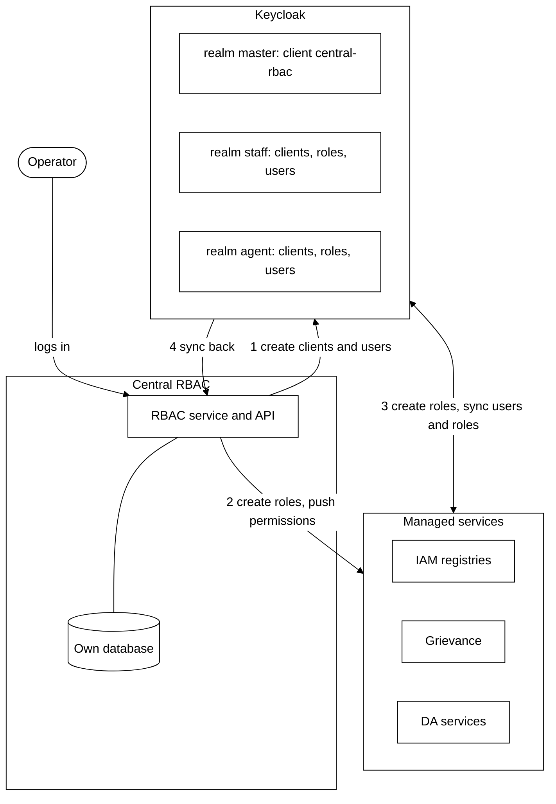
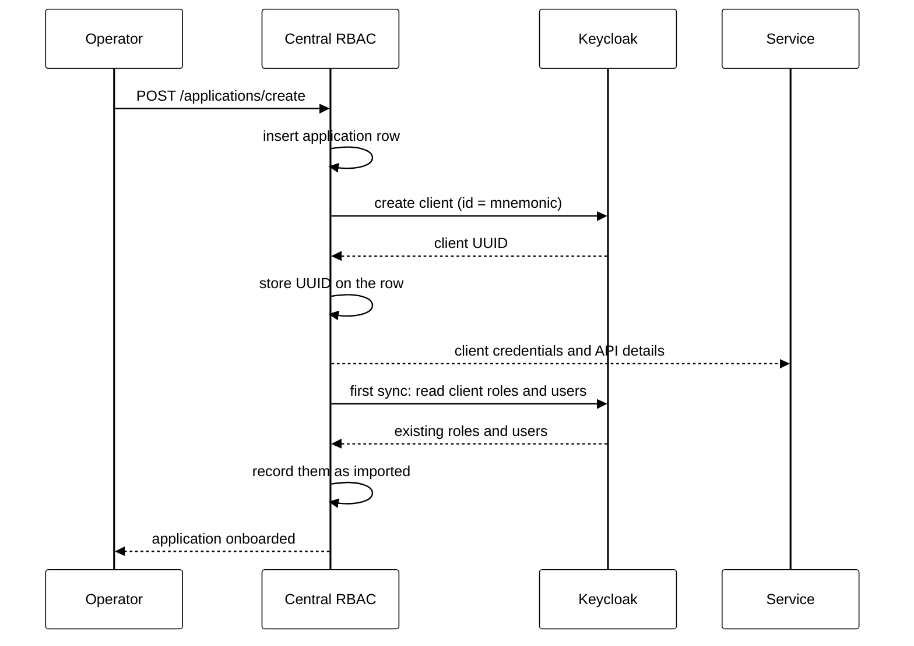
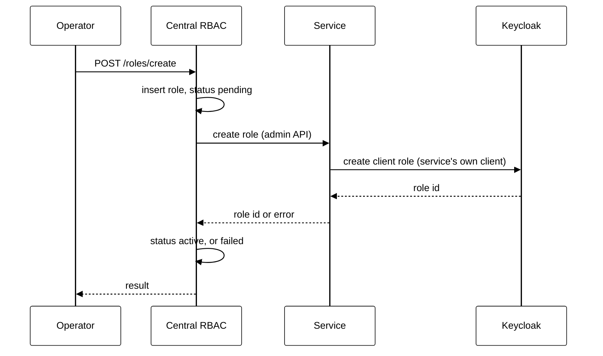
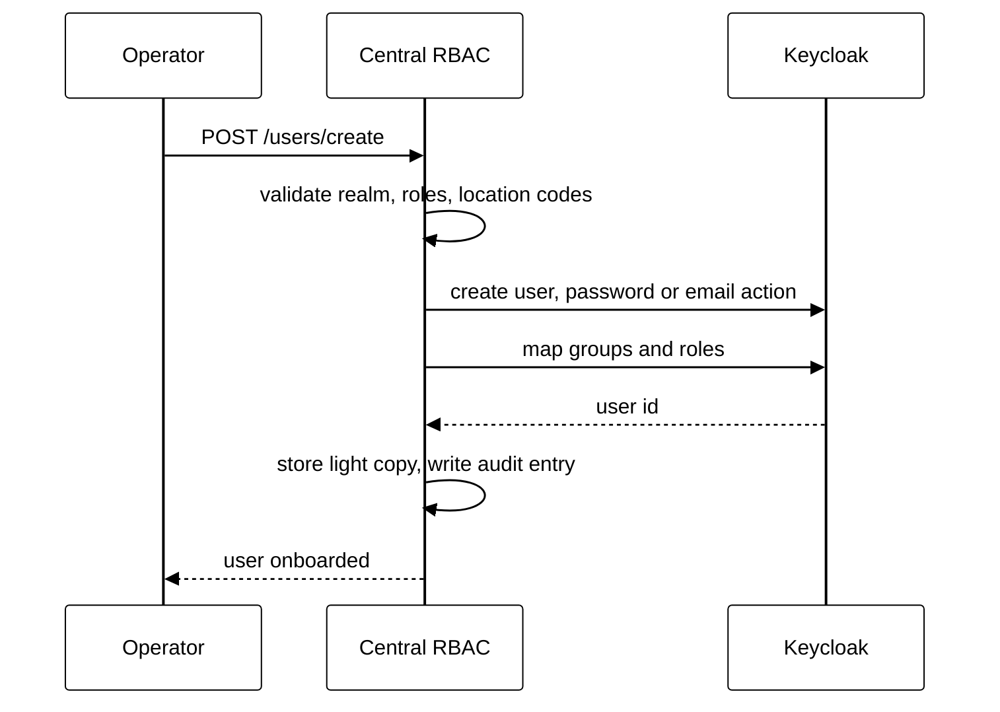

# Central RBAC: system design

Status: draft for review. Date: 2026-11-21.

This document describes a central RBAC service that copies Keycloak's structure (realms, clients, client roles, users) and adds a registry of what each role may do in each service. Keycloak stays the identity store. The central RBAC is the control plane that onboards applications, roles and users, and keeps Keycloak and the services in step.

The central RBAC has its own database. The existing IAM service and its `iam` database are not part of it. IAM is the RBAC of the registries, and it is one of the services the central RBAC manages, like the grievance service. The central RBAC is a unified layer on top of the registries and all other services.

Facts marked **[V]** were seen in this repo's earlier runs (`docs/rbac-run-record.md`, `docs/iam-database-tables.md`). Everything else is a proposal.

## 1. Goals and non-goals

Goals

- One place to onboard an application, its roles and the permissions of those roles.
- One place to onboard users. Keycloak holds the user record and credentials.
- Each service creates and syncs its own roles in Keycloak through its own Keycloak client, not through a shared admin account.
- Keycloak and the central RBAC can be reconciled in both directions, so drift is found and fixed.
- The same model for every audience (staff, agent, and so on), by using one realm per audience.

Non-goals

- Replacing Keycloak for login, tokens or passwords.
- Enforcing access inside each service. Services enforce. The central RBAC says what the rules are.
- Storing a full location master list. Only location codes are kept.

## 2. Architecture

The central RBAC copies Keycloak's layout (realms, clients, client roles, users) and adds a registry of what each role may do in each service.

Arrows 1 and 2 are calls made on a change. Arrow 3, the two-way arrow between the services and Keycloak, is each service's own sync: it creates its roles in Keycloak and pulls users and roles from Keycloak into its own database. Arrow 4, Keycloak to the central RBAC, is the scheduled and on-demand sync (section 5).

### 2.1 Realms

| Realm      | Purpose                                                                                                                                                     |
| ---------- | ----------------------------------------------------------------------------------------------------------------------------------------------------------- |
| `master` | Keycloak's own admin realm. Holds the`central-rbac` client and the service accounts that administer other realms. No end users.                           |
| `staff`  | Staff users and the staff portal applications.**[V]** this realm exists on dev with 53 `.gov.et` users, and IAM already creates client roles in it. |
| `agent`  | Agent users. Seen in an earlier failed login (discovery URL returned 404), so its state on dev is unknown.                                                  |
| others     | Added the same way. A new audience means a new realm, not new code.                                                                                         |

Every central RBAC record carries a realm. A role or user always belongs to one realm.

### 2.2 The RBAC as a client in `master`

- The client `central-rbac` lives in realm `master`. It has its own service account.
- That service account is granted admin roles (for example `manage-clients`, `manage-users`, `view-realm`) in each realm it manages. Today the caller's own token is forwarded to Keycloak, and calls fail without `realm-management` roles **[V]**. A service account removes that dependency on the caller.
- Operators log in to the central RBAC through this client. What they may do is decided by roles on `central-rbac`, so the RBAC protects itself in the same way as any application.
- Rule: nothing in the RBAC uses the Keycloak `admin` user for normal work.

## 3. Part 1: onboarding an application and its roles

### 3.1 Register the application

Call: `POST /applications/create` with realm, mnemonic, description, service URL.

1. Insert a row in the central RBAC's application registry (its own database).
2. Create a Keycloak client in the chosen realm, through the admin API. The client id equals the application mnemonic. **[V]** IAM already relies on this naming, because it finds a role's client by mnemonic.
3. Store the Keycloak client UUID on the application row, so later calls do not search by name.
4. Give the service its client credentials (client secret or service account), so it can call Keycloak itself (see 3.4). The secret is returned once and only a reference is stored.
5. Record the service's admin API base URL and how the central RBAC authenticates to it.
6. Run the first sync (section 5.1) to bring in the roles and users that already exist for this application.

If step 2 fails, roll back step 1. If step 1 fails after step 2, the reconciler (section 6) finds an orphan client and reports it.

### 3.2 Create a role

Call: `POST /roles/create` with application, role name, description.

1. Insert a row in the central RBAC's role registry, status `pending`.
2. Call the service's admin API to create the role there. The central RBAC does not call Keycloak for the role.
3. The service creates the client role in Keycloak through its own client (see 3.4).
4. The service answers with the result and the Keycloak role id. The central RBAC stores the id and sets the status to `active`. If the service fails, the status becomes `failed` with the error, and the call can be retried.
5. Permissions are then set as in section 3.3.

The central RBAC writes only to its own database and to the service. Keycloak is written only by the service.

### 3.3 Permissions per role: the RBAC doctype

A role's permissions are rules saying which action is allowed on which resource in the service.

- For Frappe-based services, a resource is a doctype and an action is a permission type (`read`, `write`, `create`, `delete`, and so on). The collection already uses `doctype` and `ptype` variables, and the grievance admin routes work on roles and permission rules.
- The central RBAC holds the rule, for example `role Grievance Officer: doctype Grievance, ptype read, write`.
- A new doctype named **RBAC** in each Frappe service holds the rules that were pushed to it. The service enforces from this doctype.
- Only what the central RBAC allows may be pushed. The central RBAC keeps an allow-list per application, listing the resources and actions it may grant. A request outside the list is rejected.
- Call: `POST /roles/{id}/permissions` with a list of resource and action pairs. The central RBAC validates the list against the allow-list, stores it, then calls the service's admin API to write the matching rows.

Open question: for non-Frappe services (for example the IAM services with `staff_application_permissions` **[V]**), the permission is a named string such as `application:create`, not a doctype. The model must support both. Proposal: a permission has `resource` and `action`, and a named permission is a resource with the action `*`.

### 3.4 Service-side role creation in Keycloak

- The service authenticates to Keycloak as its own client (client credentials) and holds only the right to manage roles on its own client, not realm-wide rights.
- On a create request from the central RBAC, the service creates the client role in Keycloak, then returns the role id.
- The same path handles update, disable and delete of a role.
- A service that has its own role screen (for example IAM) may still create roles. It reports them to the central RBAC, which records them as `pending` until accepted. The central RBAC owns role names and permission sets.
- If the service is down, the role stays `pending` or `failed`. A retry and an alert on roles stuck in either state cover this.

## 4. Part 2: onboarding users

Call: `POST /users/create` (or bulk) with realm, username, email, names, groups, location codes, roles.

1. Validate: realm exists, the roles belong to applications in that realm, the location codes exist.
2. Create the user in Keycloak: user record, a temporary password or an email action, then group and role mappings. **[V]** the same steps were done by hand for `rbac.admin`.
3. Store a light copy in the user registry: Keycloak id, realm, username, status, groups, location codes. The copy holds no password or token.
4. Write an audit entry: who asked, what changed.

User status changes (disable, delete) go to Keycloak first. The registry follows.

## 5. Sync

Two directions, both run by the central RBAC using its service account.

| Direction                       | Trigger                                    | What it does                                                                                                                                             |
| ------------------------------- | ------------------------------------------ | -------------------------------------------------------------------------------------------------------------------------------------------------------- |
| Central RBAC to service         | On every role or permission change         | Calls the service's admin API. The service writes its own role to Keycloak. This is the normal path for roles.                                           |
| Central RBAC to Keycloak        | On application and user changes            | Creates the client for an application and the user records. Roles are not written this way.                                                              |
| Service and Keycloak, both ways | Service's own schedule plus on role change | The service creates its roles in Keycloak through its own client, and syncs users and roles from Keycloak into its own database (for example grievance). |
| Keycloak to central RBAC        | Schedule plus on demand                    | Reads clients, client roles and users in a realm and updates the registry. Catches changes made directly in Keycloak.                                    |
| Service to central RBAC         | Service reports role changes               | Marks them`pending` for acceptance (3.4).                                                                                                              |

User sync from Keycloak is read-only on credentials. Only identity fields, status, groups and attributes are copied.

### 5.1 First sync when an application is onboarded

Roles and users that exist before onboarding, for example in IAM or grievance, are brought in through Keycloak, so no separate import is needed.

1. The application is onboarded (3.1). Its Keycloak client already holds the roles the service created earlier, and the realm holds the users.
2. The central RBAC reads the client roles and the users with a role on that client from Keycloak, and records them in its own database with status `imported`.
3. The role names, descriptions, Keycloak ids and user-to-role mappings are copied as they are.
4. What Keycloak does not hold is the permission set (which doctype or action each role allows). Keycloak only knows the role name. The central RBAC fills permissions in one of two ways:
   - read them from the service's admin API, where the service has a call for it (IAM has `get_role_permissions` **[V]**), or
   - leave them empty and mark the role `no permissions recorded`, until an operator sets them from the central RBAC.
5. A role that exists in the service but not in Keycloak is not found by this sync. The service's own sync to Keycloak (above) creates it in Keycloak first, then the central RBAC picks it up on the next run.
6. An operator reviews the `imported` list and accepts it. Accepting changes the status to `active`. From then on the central RBAC owns the role.

The first sync is read-only on Keycloak and the service. It changes only the central RBAC's database.

## 6. Reconciliation and drift

A scheduled job compares the registry with Keycloak and with each service, per realm:

- Client in Keycloak with no application row: orphan, report.
- Application row with no client: broken, report and offer repair.
- Role in Keycloak with no registry row, or the reverse: report.
- Permission set in the service different from the registry: report, and re-push if auto-repair is on.

Default is report only. Auto-repair is a per-application setting.

## 7. Data model (sketch)

| Table                               | Key fields                                                                                           |
| ----------------------------------- | ---------------------------------------------------------------------------------------------------- |
| `realms`                          | name, keycloak realm id, status                                                                      |
| `applications`                    | id, realm, mnemonic, keycloak client uuid, urls, owner, status                                       |
| `roles`                           | id, application, name, description, keycloak role id, status (`active`, `pending`, `disabled`) |
| `permissions`                     | id, application, resource, action, description                                                       |
| `role_permissions`                | role, permission                                                                                     |
| `allowed_permissions`             | application, resource, action (the allow-list in 3.3)                                                |
| `users`                           | id, realm, keycloak user id, username, email, status                                                 |
| `user_roles`                      | user, role                                                                                           |
| `user_groups`, `user_locations` | user, group or location code                                                                         |
| `audit_log`                       | actor, action, target, before, after, time                                                           |
| `sync_runs`                       | realm, direction, started, finished, counts, errors                                                  |

These tables live in the central RBAC's own database. IAM's tables (`staff_portal_applications`, `staff_roles`, `staff_application_permissions`, `staff_role_permissions`) are one service's data **[V]**, with the same shape as the first four tables above. IAM is onboarded as an application, and the central RBAC reads its roles and permissions through its API. A role's `status` is `pending`, `active`, `failed` or `disabled`.

## 8. API surface (sketch)

| Area         | Calls                                                                         |
| ------------ | ----------------------------------------------------------------------------- |
| Realms       | list, register                                                                |
| Applications | create, update, disable, list, rotate secret                                  |
| Roles        | create, update, disable, delete, list                                         |
| Permissions  | list, grant to role, revoke from role, manage allow-list                      |
| Users        | create, bulk create, update, disable, assign role, assign group, set location |
| Sync         | run, status, drift report                                                     |

All calls take the realm. Responses use the envelope IAM already uses (`response_header` with status and error code, `response_body` with payload) **[V]**, so existing clients keep working.

## 9. Security

- The RBAC's own service account has the smallest set of Keycloak admin roles it needs, per realm.
- Service secrets are stored in a secret store. The database keeps a reference. Responses show a secret once.
- Every write is audited with the actor and the before and after values.
- Token claims for location and groups are trusted only if they come from the realm the service expects.
- Disabling or deleting is always soft first, with a delay before the hard delete.
- Operators' rights on the RBAC come from roles on the `central-rbac` client.

## 10. Rollout

1. Create the `central-rbac` client and service account in `master`. Grant it admin roles in `staff`.
2. Create the central RBAC database with the realm and allow-list tables. Register the existing applications (15 in IAM **[V]**), link each to its Keycloak client, and run the first sync (5.1) to import their roles and users.
3. Add role create and permission push through the service APIs, starting with one service.
4. Add user onboarding, then groups and location.
5. Add the sync jobs and the drift report. Turn on auto-repair for one application first.
6. Add the `agent` realm and the next audiences.
