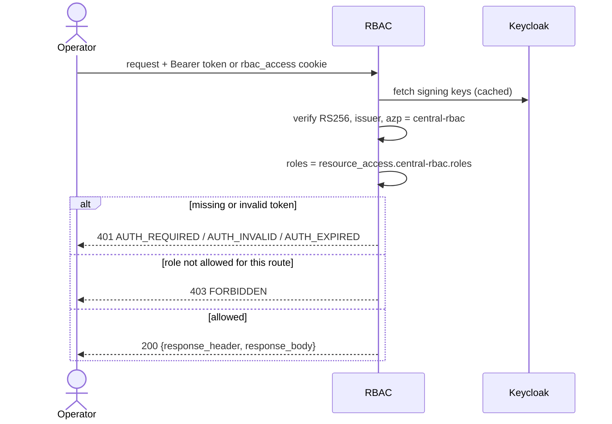
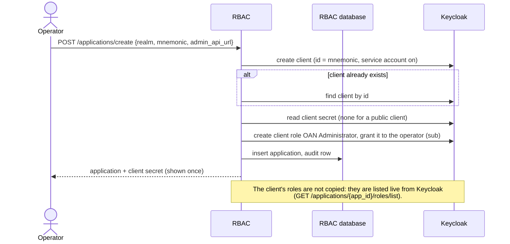
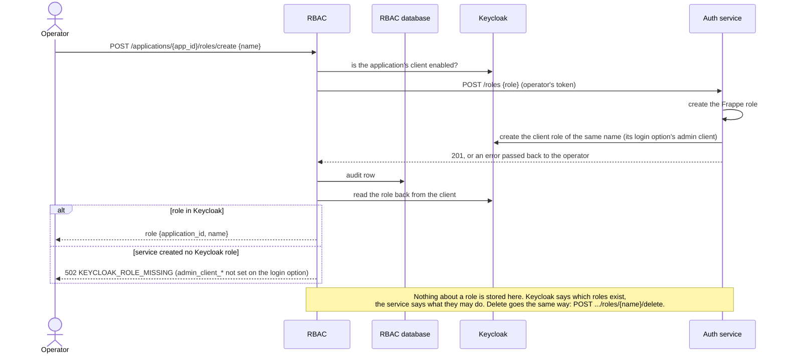
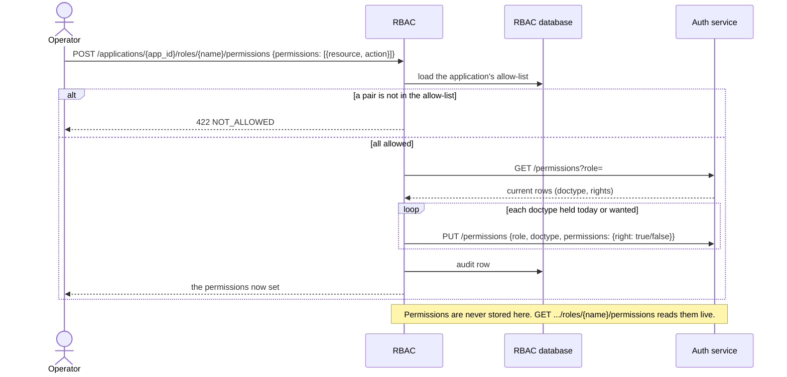
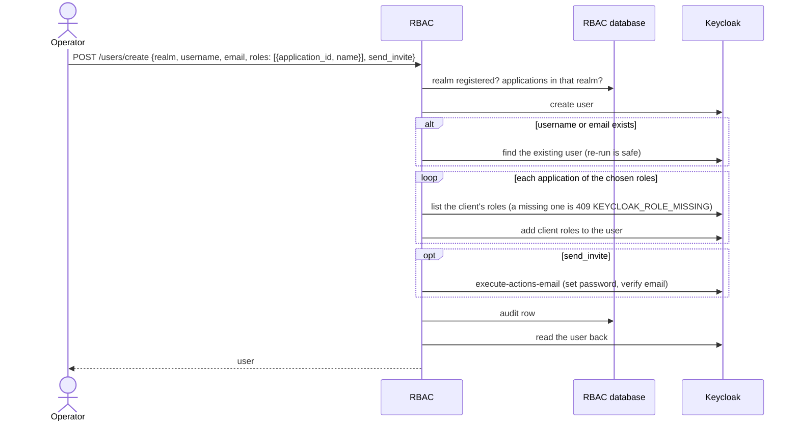

# Sequence diagrams

How the service behaves today, route by route. The design doc (`central-rbac-system-design.md`) has earlier, higher-level versions of the onboarding flows.

Participants: **Operator** (a person or script in the `staff` realm holding an `rbac-*` role on the `central-rbac` client), **RBAC** (this service), **KC** (Keycloak), **Auth service** (`oan_auth_service` admin API under `/v1/admin`, the managed service, called with the operator's own token).

## 1. Operator login

```mermaid
sequenceDiagram
    actor Op as Operator
    participant RBAC
    participant KC as Keycloak

    Op->>RBAC: GET /auth/login
    RBAC-->>Op: 302 to KC authorize (PKCE challenge, state cookie)
    Op->>KC: sign in
    KC-->>Op: 302 /auth/callback?code
    Op->>RBAC: GET /auth/callback?code&state
    RBAC->>KC: token (code + PKCE verifier + client secret)
    KC-->>RBAC: access + refresh token
    RBAC-->>Op: Set-Cookie rbac_access, rbac_refresh; 302 to post-login URL
    Note over Op,RBAC: Scripts skip this and send Authorization: Bearer <token>.<br/>Cookie writes also need x-requested-with: central-rbac.
```

## 2. Every request



## 3. Register an application



## 4. Create a role in a managed service



## 5. Set a role's permissions



## 6. Create a user


